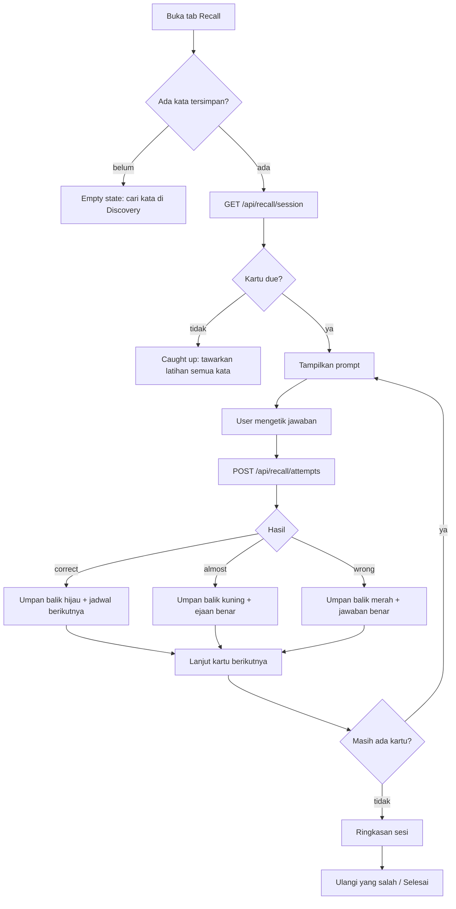
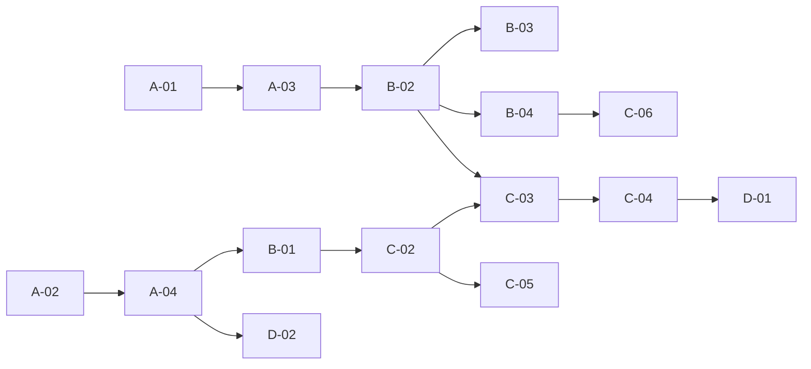

# Planning — Active Recall

Dokumen eksekusi untuk fitur **Active Recall**: latihan mengingat aktif dari
kata-kata yang **sudah tersimpan** di Remembered. Berbeda dari drill flashcard
yang sekarang (melihat kata → menilai sendiri), di sini user harus
**memproduksi** jawaban, lalu sistem menilai dan menjadwalkan ulang.

---

## 1. Ringkasan

| Aspek            | Drill sekarang (flashcard)         | Active Recall                                   |
| ---------------- | ---------------------------------- | ----------------------------------------------- |
| Arah latihan     | EN → arti (recognition)            | arti/definisi/kalimat → **EN (production)**     |
| Penilaian        | user menilai sendiri (Ingat/Lupa)  | server menilai jawaban yang diketik             |
| Penjadwalan      | acak, tanpa jadwal                 | bertahap (spaced repetition) per kata           |
| Data baru        | `remembered_count` / `forgotten_count` | `recall_streak`, `recall_due_at`, `recall_lapses`, log `recall_attempts` |
| Tujuan           | exposure & self-check              | retensi jangka panjang, menemukan kata lemah    |

Fitur ini **hanya membaca kata yang sudah ada** di `user_words`. Tidak ada
pencarian kamus baru, tidak ada penambahan kata.

### Tujuan

1. User bisa latihan tanpa mengetik kata yang tidak mereka punya.
2. Setiap jawaban dinilai objektif dan mengubah jadwal review kata tersebut.
3. Ada antrean "due today" sehingga latihan tidak acak dan tidak berulang.
4. Kata lemah terlihat jelas (statistik + daftar) dan bisa langsung dilatih.
5. Tetap ringan: satu sesi 10 kartu ≤ 10 KB payload, tanpa dependency baru.

### Non-goals

- Membuat soal dari AI / generasi kalimat baru (hanya memakai data kamus yang tersimpan).
- Mengetik kalimat penuh atau menerjemahkan paragraf.
- Sinkronisasi jadwal lintas perangkat selain lewat akun (sudah otomatis karena di DB).
- Mengganti drill flashcard yang ada; keduanya hidup berdampingan.

---

## 2. Alur User



Detail alur:

1. User membuka tab **Recall** di header.
2. Sistem mengambil sesi (default: 10 kartu, hanya yang jatuh tempo).
3. Untuk setiap kartu, user melihat **arti** (bahasa preferensi) dan mengetik
   kata bahasa Inggrisnya.
4. Enter mengirim jawaban. Server menilai, menyimpan attempt, memperbarui
   jadwal, lalu mengembalikan umpan balik.
5. User menekan Enter lagi untuk lanjut.
6. Di akhir: akurasi, daftar kata yang salah, tombol "Ulangi yang salah".

---

## 3. Mode Latihan

Empat mode, dipilih otomatis per kata (mode `auto`) atau dipaksa user.

| Mode          | Prompt yang tampil                              | Jawaban user        | Ketersediaan                        |
| ------------- | ----------------------------------------------- | ------------------- | ----------------------------------- |
| `translation` | Chip terjemahan bahasa preferensi (+ definisi)   | kata EN (diketik)   | kata punya terjemahan di bahasa itu |
| `definition`  | Definisi bahasa Inggris                         | kata EN (diketik)   | selalu (jika ada definisi)          |
| `cloze`       | Contoh kalimat dengan kata diganti `_____`      | kata EN (diketik)   | kata punya contoh yang memuat kata  |
| `choice`      | Kata EN + fonetik                               | pilih 1 dari 4 arti | butuh ≥ 4 kata dengan arti          |

**Urutan fallback `auto`:** `translation` → `definition` → `cloze`.
`cloze` hanya dipakai bila user memilihnya eksplisit atau bila tidak ada
definisi/terjemahan sama sekali.

`choice` sengaja dipisah karena sifatnya recognition, bukan production. Tetap
berguna sebagai pemanasan untuk kata yang belum punya contoh kalimat.

### Aturan pemilihan mode `auto`

1. Jika `sense.translations[preferredLanguage]` ada → `translation`.
2. Jika ada `sense.definition` → `definition`.
3. Jika ada contoh yang memuat kata → `cloze`.
4. Selain itu kata **tidak eligible** dan tidak masuk sesi.

---

## 4. Penilaian Jawaban

### Normalisasi input

Dilakukan di server (`lib/recall/grade.ts`), bukan di client:

1. `trim`, lowercase, NFKC normalize.
2. Curly quotes `’` → `'`, en/em dash → `-`.
3. Buang tanda baca di awal/akhir, collapse spasi ganda.
4. Hapus diakritik kombinasi (NFD + strip `\p{M}`), lalu NFKC kembali.
5. Batas panjang: 1–120 karakter. Di luar itu → `wrong` tanpa diproses.

### Jawaban yang diterima

Sebuah jawaban dianggap benar bila cocok dengan salah satu dari:

- `word` (headword), atau
- `entries[].forms[].word` (mis. `ate`, `eaten` untuk `eat`).

Form yang bertag `obsolete` tetap diterima (tidak berbahaya), tetapi feedback
selalu menampilkan headword.

### Hasil

| Outcome    | Kondisi                                                        | Efek jadwal                        |
| ---------- | -------------------------------------------------------------- | ---------------------------------- |
| `correct`  | cocok persis setelah normalisasi                               | `streak += 1` (atau `+2` bila cepat & tanpa hint) |
| `almost`   | Levenshtein ≤ 1 dan panjang kata ≥ 5                           | dihitung benar, `streak += 1`, tanpa bonus cepat |
| `wrong`    | tidak cocok                                                    | `streak = 0`, `lapses += 1`, due 10 menit |
| `revealed` | user menekan "Tunjukkan jawaban"                               | `streak = 0`, `lapses += 1`, due 10 menit |

`almost` tetap dihitung benar di statistik akurasi, tetapi ditandai di feedback
("Hampir benar — ejaan yang benar: …").

### Self-override

Setelah `wrong`, user boleh menekan **"Saya sebenarnya tahu"**. Ini mengubah
outcome attempt terakhir menjadi `correct` (bukan menambah attempt baru) dengan
`overridden = true`. Berguna untuk sinonim yang tidak ada di data kamus.
Override tidak memberi bonus kecepatan.

---

## 5. Spaced Repetition

Model sederhana dan deterministik (tanpa ease factor), supaya mudah diuji dan
dijelaskan ke user.

```
LADDER = [1, 3, 7, 14, 30, 60, 120]  // hari
```

| Kejadian              | `recall_streak` | `recall_due_at`                        |
| --------------------- | --------------- | -------------------------------------- |
| `correct` (normal)    | `+1`            | `now + LADDER[min(streak, 6)]` hari     |
| `correct` (cepat <3s, tanpa hint) | `+2` | `now + LADDER[min(streak, 6)]` hari     |
| `almost`              | `+1`            | `now + LADDER[min(streak, 6)]` hari     |
| `wrong`               | `0`             | `now + 10 menit`                       |
| `revealed`            | `0`             | `now + 10 menit`                       |
| Override setelah wrong| `+1`            | `now + LADDER[0]` = 1 hari             |

`recall_due_at IS NULL` berarti **belum pernah dilatih** dan dianggap due
sekarang. Karena itu kata lama otomatis masuk antrean tanpa backfill.

Kartu yang dijawab salah tetap bisa muncul lagi di sesi yang sama setelah 10
menit — tetapi sesi biasanya selesai lebih cepat, jadi praktisnya masuk sesi
berikutnya. Ini disengaja: mengulang terus-menerus di sesi yang sama bukan
retrieval practice yang baik.

---

## 6. Skema Data

```sql
-- 1. Jadwal per kata (additive, aman dijalankan ulang)
alter table public.user_words
  add column if not exists recall_streak        integer not null default 0,
  add column if not exists recall_lapses        integer not null default 0,
  add column if not exists recall_due_at        timestamptz,
  add column if not exists last_recalled_at     timestamptz;

-- 2. Log attempt (append-only, sumber statistik)
create table if not exists public.recall_attempts (
  id                uuid primary key default gen_random_uuid(),
  user_id           uuid not null references neon_auth."user"(id) on delete cascade,
  user_word_id      uuid not null references public.user_words(id) on delete cascade,
  mode              text not null check (mode in ('translation','definition','cloze','choice')),
  outcome           text not null check (outcome in ('correct','almost','wrong','revealed')),
  response          text,
  expected          text not null,
  duration_ms       integer check (duration_ms >= 0 and duration_ms <= 600000),
  used_hint         boolean not null default false,
  overridden        boolean not null default false,
  client_attempt_id text,
  created_at        timestamptz not null default now()
);

create index if not exists recall_attempts_user_created_idx
  on public.recall_attempts (user_id, created_at desc);

create index if not exists recall_attempts_user_word_idx
  on public.recall_attempts (user_word_id, created_at desc);

create index if not exists user_words_recall_due_idx
  on public.user_words (user_id, recall_due_at);

-- Idempotensi retry: satu attempt hanya dihitung sekali
create unique index if not exists recall_attempts_client_idx
  on public.recall_attempts (user_id, client_attempt_id)
  where client_attempt_id is not null;
```

Catatan:

- `expected` disimpan agar statistik dan audit tidak bergantung pada data kamus
  yang bisa berubah.
- `user_word_id` cascade: menghapus kata dari Remembered ikut menghapus
  riwayatnya, konsisten dengan perilaku sekarang.
- Tidak ada perubahan pada `remembered_count` / `forgotten_count`. Keduanya
  tetap milik flashcard (self-report), sedangkan recall punya `recall_*`.
- `review_count` **tetap dinaikkan** setiap attempt, dan `bumpActivity(userId, 0, 1)`
  dipanggil sekali per attempt sehingga streak harian ikut bertambah.

---

## 7. API

Semua endpoint: user ID dari sesi server, `401` untuk guest, `404` untuk kata
yang bukan milik user. Bahasa prompt mengikuti preferensi (A-05 di plan v2).

### 7.1 `GET /api/recall/session`

Query: `mode=auto|translation|definition|cloze|choice` (default `auto`),
`limit=10` (1–30), `scope=due|all|weak` (default `due`), `pos=all|noun|verb|adjective|other`.

Urutan antrean:

- `due`: `recall_due_at is null or recall_due_at <= now()`, lalu `recall_due_at asc nulls first`, lalu `random()`.
- `weak`: `recall_lapses desc, recall_streak asc, random()`.
- `all`: `random()`.

Response (jawaban **tidak** disertakan untuk mode mengetik):

```json
{
  "data": {
    "mode": "auto",
    "totalDue": 12,
    "totalEligible": 34,
    "cards": [
      {
        "id": "45fc8699-6ab2-4540-afdf-70c2475ceb41",
        "mode": "translation",
        "partOfSpeech": "verb",
        "prompt": {
          "kind": "translation",
          "language": "id",
          "words": ["mencapai", "meraih"],
          "definition": "To succeed in something."
        },
        "hint": { "length": 7, "initial": "a" },
        "stats": { "recallStreak": 2, "lapses": 0, "reviewCount": 5 }
      }
    ]
  }
}
```

- `hint` hanya metadata; client menampilkan setelah user menekan "Petunjuk".
- Untuk `choice`, kartu memuat `options: [{ id, word }]` (4 opsi, sudah diacak)
  dan `word` ditampilkan sebagai prompt.
- Untuk `cloze`, `prompt.kind = "cloze"` dengan `sentence: "To ___ in something."`.

### 7.2 `POST /api/recall/attempts`

Body:

```json
{
  "userWordId": "45fc8699-…",
  "mode": "translation",
  "response": "achieve",
  "durationMs": 4200,
  "usedHint": false,
  "clientAttemptId": "c1f2…"
}
```

Untuk reveal, kirim `{ "userWordId": "…", "mode": "translation", "reveal": true }`
tanpa `response`.

Response:

```json
{
  "data": {
    "outcome": "correct",
    "expected": "achieve",
    "word": "achieve",
    "phonetic": "/əˈt͡ʃiːv/",
    "translations": ["mencapai", "meraih"],
    "recallStreak": 3,
    "lapses": 0,
    "nextDueAt": "2026-10-20T16:00:00.000Z",
    "canOverride": false
  }
}
```

Aturan validasi:

- `userWordId` harus UUID milik user (query join ke `user_words`), selain itu `404`.
- `mode` harus salah satu dari 4 nilai, `400` bila tidak.
- `durationMs` di-clamp 0–600000.
- `clientAttemptId` ≤ 64 karakter; duplikat → kembalikan hasil attempt lama
  tanpa menaikkan `review_count`/streak (idempoten).

### 7.3 `PATCH /api/recall/attempts/[id]` (override)

Body `{ "overridden": true }`. Hanya attempt milik user, hanya bila
`outcome = 'wrong'` dan umurnya < 10 menit. Mengubah `outcome` menjadi
`correct`, `overridden = true`, dan memperbarui jadwal sesuai aturan override.

### 7.4 `GET /api/recall/stats`

```json
{
  "data": {
    "dueToday": 12,
    "trackedWords": 34,
    "accuracy7d": 0.78,
    "attempts7d": 96,
    "weakest": [
      { "id": "…", "word": "anguish", "lapses": 4, "accuracy": 0.25 }
    ]
  }
}
```

`weakest` maksimal 5, hanya kata dengan ≥ 3 attempt.

---

## 8. UI

### 8.1 Entry point

- Item ketiga di segmented control header: **Recall** (ikon `Brain`).
- Di bawah breakpoint `sm`, segmented control menampilkan **ikon saja**
  (`aria-label` tetap) agar tidak overflow di 320px. Ini berlaku untuk ketiga
  item, bukan hanya Recall.
- Tombol sekunder di kartu `DrillLauncher` pada Remembered:
  "Latihan Active Recall" → pindah ke view Recall.
- Di `/profile`, seksi "Active Recall" menampilkan `dueToday` dan `accuracy7d`
  dengan tombol "Mulai latihan".

### 8.2 Layout sesi

Sesi **menggantikan** kolom kiri (list), panel detail tetap tertutup, sehingga
layout tidak melompat:

```
┌─ cardClass, max-w-2xl, mx-auto ─────────────────────┐
│ Recall · 3 / 10          [× Tutup]   [progress bar] │
├─────────────────────────────────────────────────────┤
│ VERB                                                │
│ mencapai · meraih                                   │
│ "To succeed in something."                          │
│                                                     │
│ ┌─────────────────────────────────────────────────┐ │
│ │ Ketik kata bahasa Inggris…                      │ │
│ └─────────────────────────────────────────────────┘ │
│ 7 huruf · diawali "a"            [Petunjuk]         │
│                                                     │
│ [Periksa]                        [Tunjukkan jawaban]│
├─────────────────────────────────────────────────────┤
│ ✓ Benar. Berikutnya: 20 Okt 2026     [Lanjut →]     │
└─────────────────────────────────────────────────────┘
```

### 8.3 Token & komponen (wajib ikut `billien-design-md.md`)

| Elemen            | Kelas                                                                 |
| ----------------- | --------------------------------------------------------------------- |
| Kartu sesi        | `cardClass`, `p-5 sm:p-6`, `max-w-2xl mx-auto`                         |
| Progress          | track `bg-line`, isi `bg-accent`, `h-1 rounded-full`; `role="progressbar"` |
| Label mode        | 11px/700 uppercase `text-faint`                                        |
| Prompt utama      | 15px `text-ink`; chip terjemahan `rounded-full border-accent-line bg-surface` |
| Input             | `h-11 rounded-lg border-line bg-surface px-3 text-[16px]` (hindari zoom iOS), focus ring `outline-focus` |
| Feedback benar    | `border-easy bg-easy-soft/60`, ikon `CheckCircle2 text-easy`           |
| Feedback hampir   | `border-medium bg-medium-soft/60`, ikon `AlertCircle text-medium`      |
| Feedback salah    | `border-hard bg-hard-soft/60`, ikon `XCircle text-hard`                |
| Tombol utama      | `primaryButton` ("Periksa", "Lanjut", "Ulangi yang salah")             |
| Tombol sekunder   | `outlineButton` ("Petunjuk", "Tunjukkan jawaban", "Selesai")           |
| Ringkasan         | `cardClass` + `dl` dua kolom (Akurasi, Benar, Salah, Waktu rata-rata)  |

Tidak ada hex langsung. Feedback **tidak boleh** mengandalkan warna saja:
selalu ada ikon + teks.

### 8.4 Keyboard & a11y

- Input autofocus setiap kartu baru.
- `Enter` = Periksa; setelah feedback, `Enter` = Lanjut.
- `Escape` = dialog konfirmasi keluar sesi (bukan langsung keluar).
- `Tab` urutan: input → Petunjuk → Periksa → Tunjukkan jawaban.
- Feedback dibungkus `role="status"` + `aria-live="polite"`; error `role="alert"`.
- `aria-describedby` pada input menunjuk ke teks hint/instruksi.
- Progress: `aria-valuenow`, `aria-valuemin`, `aria-valuemax`, `aria-label`.

### 8.5 State

| State                  | Tampilan                                                              |
| ---------------------- | --------------------------------------------------------------------- |
| Guest                  | Prompt sign-in (pola Remembered), tanpa memanggil API                 |
| Belum punya kata       | Empty state + tombol "Cari kata di Discovery"                         |
| Loading                | Skeleton prompt 3 baris `animate-pulse`                               |
| Error                  | `role="alert"` + "Coba lagi"                                          |
| Tidak ada kartu due    | "Semua sudah jatuh tempo? Tidak — semua sudah dilatih." + tombol "Latih semua kata" (`scope=all`) |
| Sesi selesai           | Ringkasan + "Ulangi yang salah" + "Selesai"                           |
| Sesi 1 kartu           | Progress "1 / 1", tanpa pagination                                    |

---

## 9. Detail Implementasi

### 9.1 Modul baru

```
lib/recall/
  grade.ts        normalizeAnswer, levenshtein, gradeAnswer
  schedule.ts     nextSchedule(outcome, current) -> { streak, lapses, dueAt }
  cards.ts        buildCard(word, language, mode), pickMode, buildCloze, buildHint, pickDistractors
  session.ts      orderQueue, isEligible
  types.ts        RecallMode, RecallOutcome, RecallCard, RecallAttemptResult
```

Semua fungsi murni (tanpa DB/jaringan) agar bisa diuji dengan `node --test`.

### 9.2 Pembuatan cloze

1. Ambil contoh pertama yang memuat kata (word boundary, case-insensitive).
2. Ganti **satu** kemunculan pertama dengan `_____`.
3. Tolak bila kalimat < 4 kata atau kata muncul > 1 kali (biar tidak ambigu).
4. Tolak bila hasil kosong.

### 9.3 Distraktor untuk `choice`

- Ambil arti dari kata lain milik user pada bahasa yang sama.
- Buang kandidat yang berbagi arti apa pun dengan kata target.
- Utamakan POS yang sama, lalu acak; butuh minimal 3 kandidat.
- Bila kandidat < 3 → kartu fallback ke `translation` (mengetik).

### 9.4 Batas payload

Satu kartu hanya memuat: prompt, hint, statistik ringkas, dan (untuk `choice`)
4 opsi. Target: 10 kartu ≤ 10 KB. Ukur dengan `curl -w '%{size_download}'`
seperti di plan v2.

---

## 10. Index Task

| ID    | Task                                                   | Effort | UI  | Depends |
| ----- | ------------------------------------------------------ | ------ | --- | ------- |
| A-01  | Migrasi SQL (kolom jadwal + `recall_attempts`)          | S      | —   | —       |
| A-02  | `lib/recall/grade.ts` + test                            | M      | —   | —       |
| A-03  | `lib/recall/schedule.ts` + test                         | S      | —   | A-01    |
| A-04  | `lib/recall/cards.ts` (mode, cloze, hint, distraktor)   | M      | —   | A-02    |
| B-01  | `GET /api/recall/session`                               | M      | —   | A-04    |
| B-02  | `POST /api/recall/attempts` (grading + jadwal + log)    | M      | —   | A-03    |
| B-03  | `PATCH /api/recall/attempts/[id]` (override)            | S      | —   | B-02    |
| B-04  | `GET /api/recall/stats`                                 | S      | —   | B-02    |
| C-01  | Tab Recall di header + ikon-only di mobile              | S      | Ya  | —       |
| C-02  | Shell sesi, prompt, input, progress                     | M      | Ya  | B-01    |
| C-03  | Feedback + hint + reveal + override                     | M      | Ya  | B-02    |
| C-04  | Ringkasan sesi + ulangi yang salah                      | M      | Ya  | C-03    |
| C-05  | State kosong/loading/error/caught-up                    | S      | Ya  | C-02    |
| C-06  | Statistik di `/profile`                                 | S      | Ya  | B-04    |
| D-01  | Keyboard, focus, aria, 320px pass                       | S      | Ya  | C-04    |
| D-02  | Test regresi (grading, jadwal, urutan antrean)          | M      | —   | A-04    |
| D-03  | README + roadmap                                        | S      | —   | semua   |

---

## 11. Detail Task

### Fase A — Fondasi

#### A-01 Migrasi SQL

Jalankan §6 di `neon/schema.sql` + `neon/migrations/003_active_recall.sql`
(idempoten). Terapkan ke branch sementara dulu, verifikasi, baru ke `main`.

**Acceptance**

- [ ] Migrasi dua kali tanpa error
- [ ] `recall_attempts` punya FK cascade ke `user_words` dan `neon_auth."user"`
- [ ] Index `user_words_recall_due_idx` dan partial unique `client_attempt_id` ada
- [ ] Kata lama otomatis due (`recall_due_at is null`) tanpa backfill

**Effort** S · **Depends** —

---

#### A-02 Grading

`normalizeAnswer`, `levenshtein` (dibatasi panjang 120), `gradeAnswer`.

**Acceptance**

- [ ] `"Achieve "`, `"achieve."`, `"ACHİEVE"` → `correct`
- [ ] `"ate"` untuk `eat` → `correct` (lewat forms)
- [ ] `"acheive"` untuk `achieve` → `almost`
- [ ] `"xyz"` → `wrong`
- [ ] Input kosong / > 120 karakter → `wrong` tanpa throw
- [ ] `"don't"` vs `"dont"` → `wrong` (apostrof signifikan)

**Effort** M · **Depends** —

---

#### A-03 Jadwal

`nextSchedule(outcome, { streak, lapses, durationMs, usedHint }, now)`.

**Acceptance**

- [ ] `correct` pertama → due +1 hari
- [ ] `correct` beruntun → 3, 7, 14, 30, 60, 120
- [ ] `correct` < 3 s tanpa hint → melompat 2 langkah
- [ ] `wrong` / `revealed` → due +10 menit, `lapses + 1`, `streak = 0`
- [ ] Ladder mentok di 120 hari, tidak overflow

**Effort** S · **Depends** A-01

---

#### A-04 Kartu

`pickMode`, `buildCard`, `buildCloze`, `buildHint`, `pickDistractors`.

**Acceptance**

- [ ] Kata dengan terjemahan `id` → mode `translation`
- [ ] Kata tanpa terjemahan tapi ada definisi → `definition`
- [ ] Kata tanpa keduanya tapi ada contoh → `cloze`
- [ ] Kata tanpa ketiganya → tidak eligible
- [ ] Cloze menolak kalimat dengan kata muncul > 1 kali
- [ ] Distraktor tidak berbagi arti dengan target; < 3 kandidat → fallback
- [ ] Kartu mode mengetik **tidak** memuat `word` maupun `forms`

**Effort** M · **Depends** A-02

---

### Fase B — API

#### B-01 `GET /api/recall/session`

**Acceptance**

- [ ] `scope=due` mengembalikan kata `recall_due_at is null` dan yang sudah lewat
- [ ] `limit` di-clamp 1–30
- [ ] `pos` memfilter berdasarkan `entries[0].partOfSpeech`
- [ ] `totalDue` dan `totalEligible` akurat
- [ ] Guest → 401
- [ ] 10 kartu ≤ 10 KB

**Effort** M · **Depends** A-04

---

#### B-02 `POST /api/recall/attempts`

**Acceptance**

- [ ] Menyimpan attempt + memperbarui `recall_*`, `review_count`, `last_recalled_at`
- [ ] `bumpActivity(userId, 0, 1)` sekali per attempt
- [ ] `clientAttemptId` duplikat → hasil sama, tanpa double count
- [ ] Kata milik user lain → 404
- [ ] `mode` tidak dikenal → 400
- [ ] `reveal: true` mengembalikan jawaban tanpa menilai input
- [ ] `remembered_count` / `forgotten_count` tidak berubah

**Effort** M · **Depends** A-03

---

#### B-03 Override

**Acceptance**

- [ ] Hanya attempt `wrong` milik user, umur < 10 menit
- [ ] Mengubah `outcome`, menandai `overridden`, memperbarui jadwal
- [ ] Override kedua kali → 409

**Effort** S · **Depends** B-02

---

#### B-04 Statistik

**Acceptance**

- [ ] `accuracy7d` = (correct + almost) / total 7 hari terakhir
- [ ] `dueToday` memakai `recall_due_at <= now() or is null`
- [ ] `weakest` maksimal 5, minimal 3 attempt
- [ ] Tidak ada data user lain yang bocor

**Effort** S · **Depends** B-02

---

### Fase C — UI

#### C-01 Tab Recall

**Acceptance**

- [ ] Segmented control 3 item; aktif `aria-current="page"`
- [ ] Di < `sm`, hanya ikon dengan `aria-label`; tidak overflow 320px
- [ ] Ganti tab menutup detail panel dan mereset sesi

**Effort** S · **Depends** —

---

#### C-02 Shell sesi

**Acceptance**

- [ ] Autofocus input tiap kartu
- [ ] Enter memeriksa, Enter lagi melanjutkan
- [ ] Progress `role="progressbar"` akurat
- [ ] Skeleton saat loading, tidak ada layout shift

**Effort** M · **Depends** B-01

---

#### C-03 Feedback

**Acceptance**

- [ ] `correct` / `almost` / `wrong` dibedakan ikon + teks + warna token
- [ ] Hint menampilkan panjang + huruf awal tanpa membocorkan sisa kata
- [ ] Reveal menampilkan jawaban lalu menunggu "Lanjut"
- [ ] Override hanya muncul setelah `wrong`, hilang setelah dipakai
- [ ] `aria-live="polite"` mengumumkan hasil

**Effort** M · **Depends** B-02

---

#### C-04 Ringkasan

**Acceptance**

- [ ] Akurasi, jumlah benar/salah, rata-rata waktu
- [ ] Daftar kata salah beserta arti
- [ ] "Ulangi yang salah" memulai sesi dengan id tersebut
- [ ] "Selesai" kembali ke Remembered dan me-refresh cache

**Effort** M · **Depends** C-03

---

#### C-05 State

**Acceptance**

- [ ] Guest, kosong, loading, error, caught-up, dan selesai bisa dibedakan
- [ ] "Latih semua kata" memakai `scope=all`
- [ ] Error tidak menghapus progres sesi yang sudah tercatat

**Effort** S · **Depends** C-02

---

#### C-06 Profil

**Acceptance**

- [ ] Seksi Active Recall menampilkan `dueToday` + `accuracy7d`
- [ ] Tombol membuka tab Recall
- [ ] Angka mengikuti data terbaru setelah sesi (invalidate `["recall-stats"]`)

**Effort** S · **Depends** B-04

---

### Fase D — Kualitas

#### D-01 Keyboard & a11y

- [ ] Escape membuka konfirmasi, bukan keluar langsung
- [ ] Focus trap tidak diperlukan (bukan modal), tetapi urutan Tab wajar
- [ ] Tidak ada informasi yang hanya disampaikan lewat warna
- [ ] `npm run lint` 0 warning

**Effort** S · **Depends** C-04

---

#### D-02 Test

- [ ] Fixture `hello` / `eat` / `run` dipakai ulang dari plan v2
- [ ] Test grading: normalisasi, typo, forms, batas panjang
- [ ] Test jadwal: semua cabang, termasuk clamp ladder
- [ ] Test urutan antrean dan eligibility
- [ ] `npm test` lulus tanpa jaringan

**Effort** M · **Depends** A-04

---

#### D-03 Dokumentasi

- [ ] README: bagian Active Recall (mode, jadwal, endpoint)
- [ ] `docs/roadmap.md`: tandai task selesai
- [ ] Plan ini ditandai "executed" setelah selesai

**Effort** S · **Depends** semua

---

## 12. Urutan Eksekusi



**Jalur kritis:** A-01 → A-03 → B-02 → C-03 → C-04.

Saran sprint:

1. Sprint 1 — A-01…A-04 (data, grading, jadwal, kartu; tanpa UI).
2. Sprint 2 — B-01…B-04 (API lengkap + uji dengan curl).
3. Sprint 3 — C-01…C-05 (UI sesi end-to-end).
4. Sprint 4 — C-06, D-01…D-03 (profil, a11y, test, docs).

---

## 13. Risiko

| Risiko                              | Dampak                  | Mitigasi                                              |
| ----------------------------------- | ----------------------- | ----------------------------------------------------- |
| Jawaban bocor di payload            | Latihan jadi tidak sah  | Grading di server; kartu mengetik tanpa `word`/`forms` |
| Double submit / retry jaringan      | `review_count` dobel    | `clientAttemptId` + partial unique index              |
| Kata tanpa terjemahan               | Prompt kosong           | Fallback `definition` → `cloze`; selain itu tidak eligible |
| Kata tanpa contoh                   | Cloze tidak mungkin     | Mode `auto` memilih mode lain                          |
| Distraktor berbagi arti             | Soal ambigu             | Filter berbagi arti; fallback ke mengetik              |
| Typo dinilai benar                  | Retensi lemah           | `almost` hanya untuk Levenshtein ≤ 1 dan panjang ≥ 5   |
| Antrean due kosong                  | User bingung            | State caught-up + opsi `scope=all`                     |
| Sesi terlalu panjang                | Drop-off                | Default 10 kartu, bisa ditutup kapan saja              |
| Timezone                           | Due date meleset        | `timestamptz` (UTC); streak tetap Asia/Jakarta         |
| Override disalahgunakan              | Jadwal tidak akurat     | Hanya attempt `wrong` < 10 menit, sekali per attempt   |

---

## 14. Definition of Done

- [ ] `npx tsc --noEmit` bersih
- [ ] `npm run lint` bersih (0 error, 0 warning)
- [ ] `npm test` lulus (grading, jadwal, kartu, urutan antrean)
- [ ] `npm run build` sukses
- [ ] Sesi 10 kartu ≤ 10 KB (`curl -w '%{size_download}'`)
- [ ] Guest 401, kata milik user lain 404
- [ ] `remembered_count` / `forgotten_count` tidak berubah oleh recall
- [ ] Semua state UI (guest, kosong, loading, error, caught-up, selesai) bisa diuji
- [ ] Keyboard: Enter memeriksa & lanjut, Escape konfirmasi keluar
- [ ] Tidak ada hex langsung; memakai token `globals.css` / `lib/ui.ts`
- [ ] Tidak overflow horizontal di 320px
- [ ] README dan roadmap diperbarui

---

## 15. Di Luar Scope

- Generasi soal dengan LLM.
- Latihan menulis kalimat atau menerjemahkan paragraf.
- Audio-first recall (mendengar lalu mengetik) — menunggu kebutuhan.
- Sinkronisasi jadwal ke kalender / notifikasi push.
- Mode kompetitif atau leaderboard.
