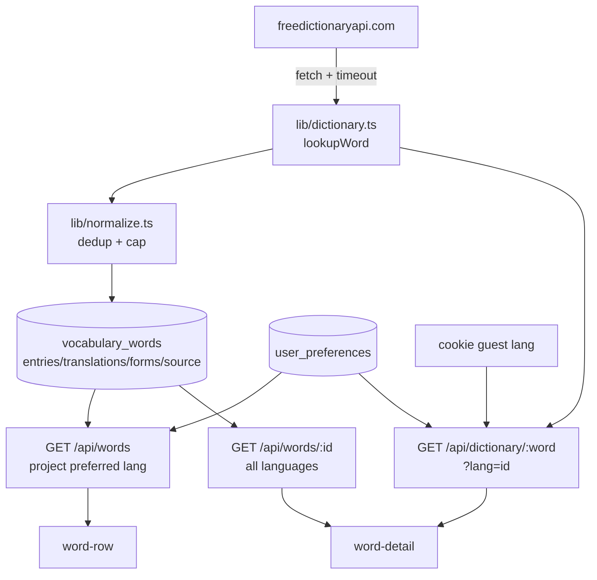
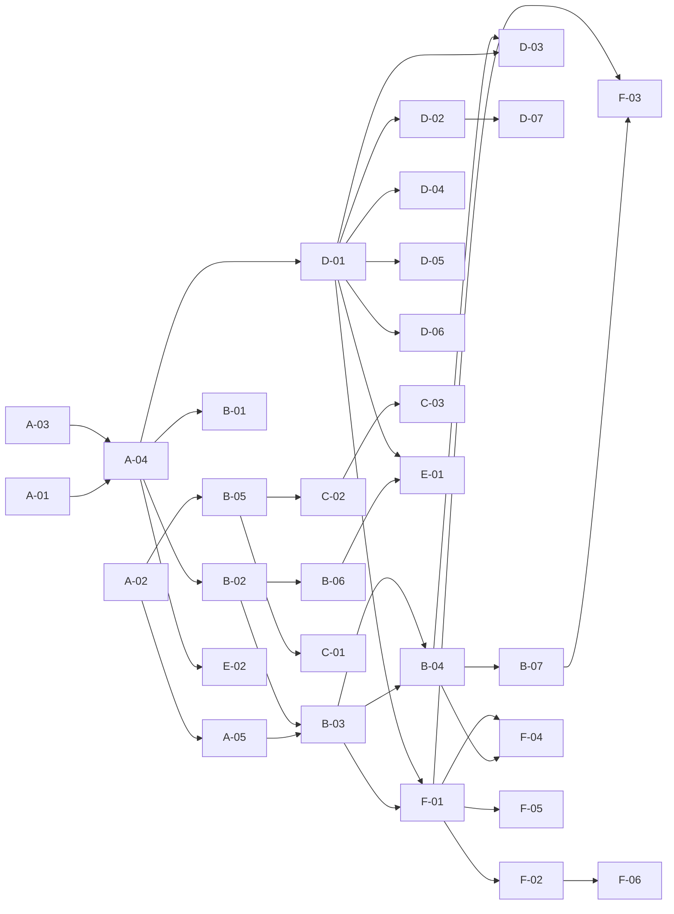

# Planning — Migrasi Dictionary API, Preferensi Bahasa & Redesign Detail

Dokumen eksekusi. Dipecah menjadi task kecil yang bisa dikerjakan berurutan.
Setiap task punya **Acceptance** yang bisa diverifikasi dan **Depends** yang jelas.

---

## 1. Ringkasan Perubahan

| Area              | Dari                            | Ke                                                   |
| ----------------- | ------------------------------- | ---------------------------------------------------- |
| Sumber kamus      | `api.dictionaryapi.dev`         | `freedictionaryapi.com/api/v1/entries/en/{word}`     |
| Bentuk data       | `meanings[]` → `definitions[]`  | `entries[]` → `senses[]` (+ `forms`, `translations`) |
| Terjemahan        | tidak ada                       | per-sense, semua bahasa, difilter preferensi user    |
| Audio             | URL mp3 dari upstream           | **tidak tersedia** di API baru (lihat Q-02)          |
| Sumber            | `sourceUrls[]` + `license`      | `source.url` + `source.license`                      |
| Preferensi bahasa | tidak ada                       | tabel `user_preferences` + halaman `/profile`        |
| Detail panel      | definisi Inggris sebagai primer | terjemahan (bahasa preferensi) sebagai primer        |

Data ukur dari API asli (`hello`): response **96 KB**, 1.341 baris terjemahan,
240 bahasa, dedup global 11 KB, dedup per-sense 21 KB. `run` = 76 KB / 69 sense.
`eat` = 0 terjemahan. Angka ini yang mendasari aturan cap di **Q-03**.

---

## 2. Keputusan yang Harus Ditetapkan Dulu

Task yang bergantung pada keputusan ini ditandai **[blocked]**.

| ID       | Pertanyaan                                   | Opsi                                                                                                      | Rekomendasi                                                      |
| -------- | -------------------------------------------- | --------------------------------------------------------------------------------------------------------- | ---------------------------------------------------------------- |
| **Q-01** | Bahasa default untuk user baru               | `en` (tanpa terjemahan) / `id`                                                                            | `id`, karena UI konten sudah berbahasa Indonesia                 |
| **Q-02** | Audio pengucapan                             | (a) hapus tombol Listen, (b) Web Speech API `speechSynthesis`, (c) tetap pakai upstream lama khusus audio | **(b)** — tanpa dependency, tanpa proxy                          |
| **Q-03** | Batas normalisasi                            | tak terbatas / cap                                                                                        | **8 sense/entry, 3 kata per bahasa per sense, 5 contoh**         |
| **Q-04** | Data lama (kata tersimpan dengan skema lama) | backfill / lazy re-fetch / drop                                                                           | **lazy re-fetch saat dibuka** (volume kecil, tidak perlu script) |
| **Q-05** | Preferensi guest                             | cookie / localStorage / tidak ada                                                                         | **cookie** agar server bisa render langsung                      |
| **Q-06** | Onboarding bahasa                            | modal saat login pertama / banner di profile                                                              | **modal** sekali, bisa dilewati                                  |
| **Q-07** | Simpan semua bahasa atau hanya preferensi    | semua / satu                                                                                              | **semua di DB**, filter di response (ganti bahasa tanpa request) |

---

## 3. Skema Target

```sql
-- 1. Bentuk baru pada kamus global
alter table public.vocabulary_words
  add column if not exists entries      jsonb not null default '[]'::jsonb,
  add column if not exists translations jsonb not null default '{}'::jsonb,
  add column if not exists forms        jsonb not null default '[]'::jsonb,
  add column if not exists source       jsonb;

-- 2. Preferensi per user
create table if not exists public.user_preferences (
  user_id uuid primary key references neon_auth."user"(id) on delete cascade,
  translation_language text not null default 'id',
  onboarded_at timestamptz,
  updated_at timestamptz not null default now()
);

-- 3. Kolom lama tetap ada selama transisi (dropped di E-02)
--    phonetic, phonetics, meanings, license, source_urls, api_entries
```

Bentuk `entries` yang disimpan (dedup, sudah di-cap):

```jsonc
[
  {
    "partOfSpeech": "interjection",
    "pronunciations": [
      { "type": "ipa", "text": "/hɛˈloʊ/", "tags": ["General American"] },
    ],
    "forms": [{ "word": "hallo", "tags": ["alternative"] }],
    "senses": [
      {
        "definition": "A greeting (salutation)…",
        "tags": [],
        "examples": ["Hello, everyone."],
        "synonyms": ["hi"],
        "antonyms": [],
        "translations": { "id": ["hai", "salam"], "es": ["hola"] },
      },
    ],
  },
]
```

`translations` (global) dipakai untuk pencarian/quick-switch tanpa membuka detail:

```jsonc
{ "id": ["hai", "salam", "halo"], "es": ["hola"], "ja": ["おはよう"] }
```

---

## 4. Arsitektur Alur Data



**Aturan proyeksi:** DB menyimpan semua bahasa; response list hanya mengirim
bahasa preferensi (hemat ~20 KB/kata). Detail mengirim semua agar ganti bahasa
instan tanpa round-trip.

---

## 5. Konvensi UI (wajib untuk semua task ber-UI)

**Aturan:** setiap task yang menyentuh antarmuka **harus** menghasilkan UI yang
mengikuti [`billien-design-md.md`](./billien-design-md.md). Tidak ada task UI yang
dianggap selesai bila hanya menyelesaikan logika tanpa tampilan yang sesuai.

### 5.1 Pemetaan token design.md → kode

Design.md memakai hex mentah; proyek memakai token di `app/globals.css`. Jangan
menulis hex langsung di komponen.

| Design.md                    | Token proyek                                  | Kelas Tailwind                       |
| ---------------------------- | --------------------------------------------- | ------------------------------------ |
| Primary dark `#18181B`       | `--color-primary`                             | `bg-primary`, `text-primary`         |
| Accent `#7C3AED`             | `--color-accent`                              | `bg-accent`, `text-accent`           |
| Accent soft                  | `--color-accent-soft` / `--color-accent-line` | `bg-accent-soft`, `ring-accent-line` |
| Background `#FFFFFF`         | `--color-surface`                             | `bg-surface`                         |
| Sidebar/subtle `#FAFAFA`     | `--color-subtle` / `--color-sunken`           | `bg-subtle`                          |
| Border `#E4E4E7`             | `--color-line`                                | `border-line`                        |
| Text primary `#09090B`       | `--color-ink`                                 | `text-ink`                           |
| Text secondary `#64748B`     | `--color-muted`                               | `text-muted`                         |
| Text muted `#94A3B8`         | `--color-faint`                               | `text-faint`                         |
| Hard `#DC2626` / `#FEE2E2`   | `--color-hard` / `--color-hard-soft`          | `text-hard`, `bg-hard-soft`          |
| Medium `#D97706` / `#FEF3C7` | `--color-medium` / `--color-medium-soft`      | `text-medium`, `bg-medium-soft`      |
| Easy `#16A34A` / `#DCFCE7`   | `--color-easy` / `--color-easy-soft`          | `text-easy`, `bg-easy-soft`          |

Tipografi: **Inter** (`--font-inter`), H1 20–22px/600–700, H2 14px/600,
label 12px/500 `text-muted`, body 13–14px, caption 11–12px/500.
Radius: tombol & badge `rounded-lg` (8px), pill `rounded-full`.
Elevasi: flat + `border` 1px, `shadow-sm` hanya untuk kartu/tombol utama.

### 5.2 Komponen bersama

Gunakan ulang, jangan duplikasi:

- `lib/ui.ts` → `cardClass`, `primaryButton`, `outlineButton`, `headerOutline`
- `components/app/app-header.tsx` → header dua kartu
- `components/words/word-row.tsx` → baris kata
- `components/auth/auth-modal.tsx` → pola modal (overlay, focus trap, Escape)

Bila butuh varian baru, **tambahkan ke `lib/ui.ts`**, bukan string lepas di komponen.

### 5.3 Checklist UI per task

- [ ] Memakai token, bukan hex
- [ ] State: default, hover, focus-visible, disabled, loading, empty, error
- [ ] Keyboard: Tab order wajar, Escape menutup overlay, fokus kembali ke pemicu
- [ ] Label: `aria-label` untuk ikon-saja, `role="status"` untuk notifikasi,
      `role="alert"` untuk error, `aria-pressed` untuk toggle
- [ ] Tidak ada overflow horizontal di 320px
- [ ] Teks panjang memakai `wrap-anywhere` / `line-clamp`
- [ ] Verifikasi: `npm run lint` + `npm run build` + cek HTML render

### 5.4 Task yang wajib punya deliverable UI

| Task      | UI yang harus dibuat                                |
| --------- | --------------------------------------------------- |
| C-01      | Modal onboarding pilihan bahasa (pola `auth-modal`) |
| C-02      | Halaman `/profile` lengkap                          |
| C-03      | Item menu Profile di header                         |
| D-02…D-07 | Panel detail kata                                   |
| F-01…F-06 | Tampilan Remembered                                 |

Task API murni (A-*, B-01…B-06, E-02) tidak perlu UI, tetapi wajib menyertakan
contoh response di deskripsinya agar konsumen UI bisa dikerjakan paralel.

---

## 6. Index Task

Kolom **UI** menandai task yang punya deliverable antarmuka (lihat §5).

| ID       | Task                                            | Effort | UI  | Depends    |
| -------- | ----------------------------------------------- | ------ | --- | ---------- |
| **A-01** | Tipe domain baru + adaptor legacy               | S      | —   | —          |
| **A-02** | Migrasi SQL (kolom + `user_preferences`)        | S      | —   | —          |
| **A-03** | Client fetch API baru                           | S      | —   | —          |
| **A-04** | Normalizer (dedup, cap, forms, source)          | M      | —   | A-01, A-03 |
| **A-05** | Resolusi preferensi (user + guest)              | S      | —   | A-02       |
| **B-01** | `/api/dictionary/[word]` bentuk baru + `?lang`  | S      | —   | A-04       |
| **B-02** | `POST /api/words` pakai normalizer baru         | S      | —   | A-04       |
| **B-03** | `GET /api/words` proyeksi bahasa preferensi     | S      | —   | A-05, B-02 |
| **B-04** | `GET /api/words/[id]` (baru, semua bahasa)      | S      | —   | B-03       |
| **B-05** | `/api/preferences` GET + PATCH                  | S      | —   | A-02       |
| **B-06** | Lazy re-fetch data legacy                       | M      | —   | B-02, Q-04 |
| **B-07** | `DELETE /api/words/[id]` (un-save)              | S      | —   | B-04       |
| **C-01** | Onboarding modal bahasa (login pertama)         | M      | Ya  | B-05, Q-06 |
| **C-02** | Halaman `/profile` + form preferensi            | M      | Ya  | B-05       |
| **C-03** | Menu akun → tautan Profile                      | S      | Ya  | C-02       |
| **D-01** | Update pembaca lama → bentuk baru               | M      | —   | A-04       |
| **D-02** | Detail: header (kata, fonetik, POS, aksi)       | S      | Ya  | D-01       |
| **D-03** | Detail: blok terjemahan per preferensi          | M      | Ya  | D-01, B-04 |
| **D-04** | Detail: forms, contoh, sinonim/antonim          | M      | Ya  | D-01       |
| **D-05** | Detail: status hafal + riwayat review           | S      | Ya  | D-01       |
| **D-06** | Detail: sumber + lisensi                        | S      | Ya  | D-01       |
| **D-07** | Audio via `speechSynthesis` **[blocked: Q-02]** | M      | Ya  | Q-02       |
| **E-01** | Hapus route & kolom legacy                      | S      | —   | B-06, D-01 |
| **E-02** | Unit test normalizer + helper                   | M      | —   | A-04       |
| **E-03** | Perbarui README & roadmap                       | S      | —   | semua      |
| **F-01** | Remembered: baris terjemahan-first              | M      | Ya  | B-03, D-01 |
| **F-02** | Remembered: search + filter POS + sort          | M      | Ya  | F-01       |
| **F-03** | Remembered: un-save + optimistic update         | M      | Ya  | B-07, F-01 |
| **F-04** | Remembered: detail pakai semua bahasa           | S      | Ya  | B-04, F-01 |
| **F-05** | Remembered: empty/loading/error + counter       | S      | Ya  | F-01       |
| **F-06** | Remembered: bulk drill dari hasil filter        | S      | Ya  | F-02       |

---

## 7. Detail Task

### Fase A — Fondasi

#### A-01 Tipe domain baru + adaptor legacy

**Scope.** Ganti tipe kamus di `lib/types.ts`.

```ts
export type Translation = {
  language: { code: string; name: string };
  word: string;
};
export type Sense = {
  definition: string;
  tags: string[];
  examples: string[];
  synonyms: string[];
  antonyms: string[];
  translations: Record<string, string[]>; // sudah dedup
};
export type Entry = {
  partOfSpeech: string;
  pronunciations: { type: string; text: string; tags: string[] }[];
  forms: { word: string; tags: string[] }[];
  senses: Sense[];
};
export type DictionaryResult = {
  word: string;
  entries: Entry[];
  source: { url: string; license: { name: string; url: string } | null } | null;
};
```

Tambah `legacyToResult(row)` untuk membaca baris lama (`meanings`, `phonetics`,
`api_entries`) menjadi `DictionaryResult` agar UI tidak pecah selama transisi.

**Acceptance**

- [ ] `npx tsc --noEmit` bersih
- [ ] `legacyToResult` mengubah baris `meanings` lama menjadi minimal 1 `Entry`
- [ ] `SavedWord` punya `entries`, `translations`, `forms`, `source`, dan field lama ditandai `@deprecated`

**Effort** S · **Depends** —

---

#### A-02 Migrasi SQL

**Scope.** Jalankan §3 di `neon/schema.sql` + file migrasi terpisah
`neon/migrations/001_dictionary_v2.sql` (idempoten, `if not exists`).

**Acceptance**

- [ ] Migrasi bisa dijalankan dua kali tanpa error
- [ ] `user_preferences` punya FK cascade ke `neon_auth."user"`
- [ ] Baris lama tidak berubah (`entries` default `'[]'`)

**Effort** S · **Depends** —

---

#### A-03 Client fetch API baru

**Scope.** `lib/dictionary.ts` → `lookupWord(word, { translations: true })`
memanggil `https://freedictionaryapi.com/api/v1/entries/en/{word}?translations=true`.
Validasi bentuk (`word` string, `entries` array), timeout 8 s, cache
`revalidate: 7 hari`, error 404 → "Word not found.".

**Acceptance**

- [ ] Response non-JSON / 5xx / timeout → pesan error yang bisa ditampilkan
- [ ] `word` divalidasi dengan regex yang sama seperti sekarang
- [ ] Tidak ada dependency baru

**Effort** S · **Depends** —

---

#### A-04 Normalizer

**Scope.** `lib/normalize.ts`:

1. Map `entries[]` → `Entry[]` (buang `language`, `subsenses`).
2. `senses[]`: buang `quotes`, `subsenses`; cap **8 sense/entry**.
3. `translations`: `Sense.translations[]` → `Record<code, string[]>`, dedup,
   cap **3 kata/bahasa/sense**.
4. `forms[]`: dedup by `word`, cap 12.
5. `examples`: cap **5**.
6. `source`: `{ url, license }`; `null` bila tidak ada.
7. Hasil akhir `{ entries, translations, forms, source, phonetic }` di mana
   `phonetic` = `entries[0].pronunciations[0].text` (kompatibilitas baris list).

**Acceptance**

- [ ] `hello` menghasilkan 3 entry, ≤8 sense/entry, `translations.id` berisi `hai`/`salam`
- [ ] `run` (69 sense) terpotong ke ≤8 sense/entry dan JSON < 20 KB
- [ ] `eat` (0 terjemahan) menghasilkan `translations = {}` tanpa error
- [ ] Tidak ada `subsenses` di output

**Effort** M · **Depends** A-01, A-03

---

#### A-05 Resolusi preferensi

**Scope.** `lib/preferences.ts` → `resolveLanguage(req)`:
prioritas (1) `user_preferences.translation_language` bila login,
(2) cookie `billien_lang` untuk guest, (3) default `id`.

**Acceptance**

- [ ] Guest dengan cookie `en` mendapat `en`
- [ ] User login menang atas cookie
- [ ] Nilai tak dikenal jatuh ke default, bukan error

**Effort** S · **Depends** A-02

---

### Fase B — API

#### B-01 `/api/dictionary/[word]`

**Scope.** Kembalikan `DictionaryResult`. Tambah `?lang=` (default dari A-05);
`?lang=all` mengembalikan semua bahasa (dipakai detail).

**Acceptance**

- [ ] `?lang=id` → hanya `translations.id`
- [ ] `?lang=all` → semua bahasa
- [ ] Error 400 untuk kata tidak valid, 404 untuk tidak ditemukan

**Effort** S · **Depends** A-04

---

#### B-02 `POST /api/words`

**Scope.** Ganti `normalizeForInsert` dengan normalizer baru; tulis `entries`,
`translations`, `forms`, `source`. Field lama diisi turunan selama transisi.

**Acceptance**

- [ ] Simpan `hello` lalu baca ulang → `entries` utuh
- [ ] Simpan kata yang sudah ada → `alreadySaved: true`, tidak menimpa data
- [ ] Kata dengan 0 terjemahan tetap tersimpan

**Effort** S · **Depends** A-04

---

#### B-03 `GET /api/words` (list)

**Scope.** Proyeksikan hanya bahasa preferensi: `entries[].senses[].translations`
dipangkas ke satu kode. Field `forms`, `partOfSpeech`, `definition` tetap.

**Acceptance**

- [ ] Payload 8 kata < 25 KB (ukur dengan `curl -w %{size_download}`)
- [ ] `?lang=all` tersedia untuk kebutuhan lain
- [ ] Kontrak `data: SavedWord[]` tidak berubah bentuk luar

**Effort** S · **Depends** A-05, B-02

---

#### B-04 `GET /api/words/[id]`

**Scope.** Endpoint baru: satu kata, semua bahasa. Validasi kepemilikan via sesi.
`404` bila bukan milik user.

**Acceptance**

- [ ] User lain mendapat 404, bukan data
- [ ] Guest mendapat 401
- [ ] Response memuat semua kode bahasa

**Effort** S · **Depends** B-03

---

#### B-05 `/api/preferences`

**Scope.** `GET` → `{ translationLanguage, onboardedAt }`; `PATCH` body
`{ translationLanguage }` (whitelist kode yang dikenal, mis. `id`, `en`, `es`).

**Acceptance**

- [ ] PATCH kode tak dikenal → 400
- [ ] PATCH guest → 401
- [ ] GET user tanpa baris → default `id`, `onboardedAt: null`

**Effort** S · **Depends** A-02

---

#### B-06 Lazy re-fetch data legacy

**Scope.** Saat detail dibuka dan `entries` kosong tetapi `api_entries` ada →
fetch ulang dari API baru, normalisasi, update baris. Tandai `entries_fetched_at`.

**Acceptance**

- [ ] Kata lama terbuka normal tanpa error
- [ ] Hanya satu fetch per kata (idempoten)
- [ ] Kegagalan fetch tidak menghapus data lama

**Effort** M · **Depends** B-02, Q-04

---

#### B-07 `DELETE /api/words/[id]` (un-save)

**Scope.** Hapus relasi `user_words` milik user (bukan `vocabulary_words`, yang
bersifat global). Validasi kepemilikan lewat sesi. Kembalikan `{ data: { id } }`.

**Acceptance**

- [ ] User lain mendapat 404
- [ ] Guest mendapat 401
- [ ] Kata global tetap ada untuk user lain
- [ ] `learned_count` hari itu **tidak** dikurangi (riwayat aktivitas tetap)

**Effort** S · **Depends** B-04

---

### Fase C — Preferensi & Profile

#### C-01 Onboarding modal bahasa

**Scope.** Setelah login, bila `onboardedAt == null` → tampilkan modal pilihan
bahasa (ID/EN/ES + "Skip"). Pilihan disimpan via PATCH; skip mengisi
`onboarded_at` tanpa mengubah bahasa.

**UI (wajib, ikuti §5).**

- Komponen baru `components/preferences/language-modal.tsx`
- Pola sama dengan `components/auth/auth-modal.tsx`: overlay `bg-black/50`,
  panel `cardClass`, focus trap, Escape, klik overlay
- Isi: judul 20px/700, deskripsi 13px `text-muted`, 3 kartu pilihan
  (`rounded-lg border-line`, state terpilih `border-accent bg-accent-soft`),
  tombol `primaryButton` "Simpan" + `outlineButton` "Lewati"
- Setiap opsi menampilkan nama bahasa + contoh kata (`halo` / `hello` / `hola`)

**Acceptance**

- [ ] Muncul sekali per akun, tidak muncul lagi setelah skip
- [ ] Modal tidak menghalangi redirect OAuth (muncul setelah sesi siap)
- [ ] Bisa ditutup dengan Escape
- [ ] Opsi terpilih terlihat jelas tanpa mengandalkan warna saja (ada ikon centang)
- [ ] Mobile 320px: kartu menumpuk, tidak ada overflow horizontal

**Effort** M · **Depends** B-05, Q-06

---

#### C-02 Halaman `/profile`

**Scope.** `app/profile/page.tsx` (server, ambil sesi) + form client:

- Bahasa terjemahan (radio/select)
- Info akun (nama, email dari sesi)
- Ringkasan: jumlah kata tersimpan, streak
- Sign out

**UI (wajib, ikuti §5).**

- Layout: kartu `cardClass` di atas `bg-canvas`, maksimal `max-w-2xl`
- Header halaman: judul 20–22px/700 + subjudul 13px `text-muted`
- Seksi "Bahasa terjemahan": daftar opsi sebagai baris `rounded-lg border-line`
  dengan radio native (bukan kustom) agar keyboard-friendly; baris aktif
  `border-accent bg-accent-soft`
- Seksi "Akun": `dl` dua kolom (`text-muted` / `text-ink font-semibold`)
- Tombol simpan `primaryButton`; status simpan lewat `role="status"`
- Tautan kembali ke beranda di atas kartu (`text-accent`)

**Acceptance**

- [ ] Guest diarahkan ke `/` (atau prompt sign-in)
- [ ] Simpan bahasa → detail langsung memakai bahasa baru tanpa reload manual
- [ ] Gaya mengikuti `docs/billien-design-md.md` (Inter, border `#e4e4e7`, radius 8px)
- [ ] Hanya memakai token dari `lib/ui.ts` + `globals.css` (tidak ada hex)
- [ ] State: default, focus-visible, disabled saat menyimpan, error bila PATCH gagal

**Effort** M · **Depends** B-05

---

#### C-03 Menu akun → Profile

**Scope.** `components/app/app-header.tsx`: tambah item "Profile" di atas Sign out.

**UI (wajib, ikuti §5).**

- Item `role="menuitem"` dengan ikon `UserRound`, tinggi baris konsisten dengan
  Sign out, hover `bg-hover`, focus-visible ring
- Divider `bg-line` antara Profile dan Sign out

**Acceptance**

- [ ] Navigasi ke `/profile`, menu tertutup otomatis
- [ ] Fokus keyboard tetap benar (`role="menuitem"`)
- [ ] Escape menutup menu dan mengembalikan fokus ke tombol 3 dots

**Effort** S · **Depends** C-02

---

### Fase D — UI Detail

#### D-01 Update pembaca lama

**Scope.** Ganti akses `meanings[].definitions[]` → `entries[].senses[]` di:
`lib/library.ts` (`primaryDefinition`, `posBucket`, `buildFilters`, `filterItems`),
`components/words/word-row.tsx`, `components/drill/drill-panel.tsx`,
`hooks/use-word-library.ts`.

**Acceptance**

- [ ] POS badge tetap muncul di list
- [ ] Drill tetap menampilkan definisi utama
- [ ] Tidak ada referensi `meanings` tersisa di komponen

**Effort** M · **Depends** A-04

---

#### D-02 Header detail

**Scope.** Kata + fonetik IPA + chip POS + tombol aksi. Fonetik diambil dari
`entries[0].pronunciations[0].text`; bila >1 varian, tampilkan yang pertama
dengan `title` berisi sisanya.

**UI (wajib, ikuti §5).**

- Judul kata 28px/700 `text-ink` + fonetik 13px `text-muted italic`
- Chip POS: `rounded-full bg-accent-soft text-accent ring-1 ring-accent-line`,
  maksimal 3, `wrap-anywhere` pada kata
- Tombol aksi `outlineButton` tinggi 36px (Listen / Simpan)

**Acceptance**

- [ ] Kata panjang tidak overflow (`wrap-anywhere`)
- [ ] Chip POS unik, maksimal 3
- [ ] Tinggi kontrol konsisten 36px (mengikuti pola header)
- [ ] Tidak ada hex langsung; memakai token §5.1

**Effort** S · **Depends** D-01

---

#### D-03 Blok terjemahan

**Scope.** Blok utama pengganti definisi Inggris. Judul mengikuti preferensi:
`ARTI / DEFINISI (BAHASA INDONESIA)` untuk `id`. Isi: chip terjemahan per sense
(maks 3), lalu definisi Inggris sebagai sekunder (collapsible).

**UI (wajib, ikuti §5).**

- Kartu `rounded-xl border border-line bg-subtle p-4` (pola blok detail sekarang)
- Label seksi 11px/700 uppercase `text-muted` + ikon `Languages` `text-faint`
- Terjemahan utama 15px `text-ink` (bukan italic) sebagai baris terdepan
- Definisi Inggris sekunder di dalam `<details>` dengan ringkasan 12px
  `text-muted`; default tertutup
- Bila kosong: teks 13px `text-muted` "Terjemahan belum tersedia" +
  definisi Inggris tetap tampil

**Acceptance**

- [ ] `id` → menampilkan `hai`, `salam`
- [ ] Tidak ada terjemahan → tampilkan definisi Inggris + catatan "Terjemahan belum tersedia"
- [ ] Ganti bahasa di profile → blok berubah tanpa fetch ulang (pakai B-04)
- [ ] `<details>` bisa dibuka dengan keyboard (Enter/Space)

**Effort** M · **Depends** D-01, B-04

---

#### D-04 Forms, contoh, sinonim/antonim

**Scope.** Chip bentuk kata (`eat · ate · eaten`) dari `entries[].forms`,
contoh bernomor (maks 3), chip sinonim/antonim.

**UI (wajib, ikuti §5).**

- Forms: chip `rounded-full border border-line bg-surface text-ink-soft` 11px,
  dipisah titik tengah `·`
- Contoh: kartu bernomor `rounded-xl border border-line bg-surface p-3`,
  angka dalam bulatan `bg-accent-soft text-accent`
- Sinonim: chip `border-line bg-surface text-ink-soft`
- Antonim: chip `border-hard-soft bg-hard-soft/60 text-hard`

**Acceptance**

- [ ] Forms kosong → blok tidak dirender
- [ ] Contoh diambil dari semua sense, dedup
- [ ] Antonim memakai token `hard`, sinonim `line` (sesuai design token)
- [ ] Maksimal 3 contoh, 6 chip per kategori

**Effort** M · **Depends** D-01

---

#### D-05 Status hafal + riwayat

**Scope.** Blok "Sudah Dihafalkan" + tanggal, jumlah review, ingat/lupa.
Tetap memakai data `user_words`.

**UI (wajib, ikuti §5).**

- Banner status `rounded-xl border border-line bg-subtle p-4` dengan ikon
  `CheckCircle2 text-easy`
- Riwayat sebagai `dl` dua kolom: label 12px `text-muted`, nilai 12px/600 `text-ink`
- Tombol hapus kata (un-save) memakai `outlineButton` + ikon `Trash2`,
  konfirmasi inline (bukan `window.confirm`)

**Acceptance**

- [ ] Tidak ada regresi pada tombol Tandai Sudah Hafal
- [ ] Angka review akurat setelah drill
- [ ] Konfirmasi un-save bisa dibatalkan dengan Escape

**Effort** S · **Depends** D-01

---

#### D-06 Sumber + lisensi

**Scope.** `source.url` sebagai tautan, `source.license.name` + tautan lisensi.
Menggantikan daftar `source_urls`.

**UI (wajib, ikuti §5).**

- Seksi dengan `border-t border-line-soft pt-4`
- Label 11px/700 uppercase `text-muted`
- Tautan 12px `text-accent underline decoration-accent-line wrap-anywhere`
- Lisensi ditampilkan sebagai teks 11px `text-faint` di bawah tautan

**Acceptance**

- [ ] Lisensi tampil (mis. `CC BY-SA 4.0`)
- [ ] `source` null → blok disembunyikan
- [ ] Tautan `target="_blank"` + `rel="noreferrer"`

**Effort** S · **Depends** D-01

---

#### D-07 Audio via Web Speech API **[blocked: Q-02]**

**Scope.** Ganti tombol Listen: `speechSynthesis.speak(new SpeechSynthesisUtterance(word))`
dengan `lang = "en-US"`. Hapus `/api/asset` bila Q-02 = (b).

**UI (wajib, ikuti §5).**

- Tombol `outlineButton` 36px + ikon `Volume2`, label "Listen" + fonetik
- State berbicara: ikon `animate-pulse`, `aria-pressed="true"`
- Fallback: tombol tidak dirender bila `speechSynthesis` tidak ada

**Acceptance**

- [ ] Tombol berfungsi di Chrome/Safari
- [ ] Tidak ada request jaringan
- [ ] Fallback: tombol disembunyikan bila `speechSynthesis` tidak ada
- [ ] `speechSynthesis.cancel()` dipanggil saat unmount / ganti kata

**Effort** M · **Depends** Q-02

---

### Fase E — Pembersihan & Kualitas

#### E-01 Hapus legacy

**Scope.** Hapus `app/api/dictionary/route.ts` (dead code), `/api/asset` (bila
Q-02 = b), lalu `alter table ... drop column` untuk `meanings`, `phonetics`,
`license`, `source_urls`, `api_entries` setelah semua baris punya `entries`.

**Acceptance**

- [ ] Tidak ada referensi kolom/route yang dihapus
- [ ] `npm run build` hijau
- [ ] Data lama sudah termigrasi (query verifikasi: `select count(*) from vocabulary_words where jsonb_array_length(entries) = 0` → 0)

**Effort** S · **Depends** B-06, D-01

---

#### E-02 Unit test

**Scope.** Vitest + `npm test`. Uji `normalizeEntry` (cap, dedup, subsense drop),
`resolveLanguage`, `paginate`, `filterItems`.

**Acceptance**

- [ ] `npm test` lulus
- [ ] Fixture `hello`, `run`, `eat` disimpan sebagai JSON kecil
- [ ] Tidak ada test yang memanggil jaringan

**Effort** M · **Depends** A-04

---

#### E-03 Dokumentasi

**Scope.** Perbarui `README.md` (endpoint baru, preferensi, audio), `docs/roadmap.md`
(tandai T-09/T-10 selesai), dan tambah bagian skema baru.

**Acceptance**

- [ ] README tidak menyebut `dictionaryapi.dev`
- [ ] Roadmap menandai task yang selesai

**Effort** S · **Depends** semua

---

### Fase F — Remembered (end-to-end)

Fase ini membuat view **Remembered** benar-benar selesai: bukan hanya daftar kata,
tetapi menampilkan terjemahan sesuai preferensi, bisa dicari, difilter, diurutkan,
dan bisa dihapus. Semua UI mengikuti §5.

#### F-01 Remembered: baris terjemahan-first

**Scope.** Ubah `components/words/word-row.tsx` agar menerima `translation?: string[]`
dan menampilkannya sebagai baris utama di bawah kata (bukan definisi Inggris).
Definisi Inggris menjadi baris sekunder 11px `text-faint` (maks 1 baris, `line-clamp-1`).
`hooks/use-word-library.ts` memetakan `translations[lang]` dari `SavedWord`.

**UI (wajib, ikuti §5).**

- Nama kata 14px/600 `text-ink`; terjemahan 12px `text-ink-soft`
- Chip POS tetap `bg-accent-soft text-accent`
- State aktif: `border-accent bg-accent-soft`; hover: `bg-hover`
- State tersimpan: ikon `Check` dalam kotak `bg-easy-soft text-easy`

**Acceptance**

- [ ] Dengan preferensi `id`, baris menampilkan `hai` / `salam`, bukan definisi Inggris
- [ ] Tanpa terjemahan → fallback ke definisi Inggris (tidak ada baris kosong)
- [ ] Kata panjang + terjemahan panjang tidak overflow di 320px
- [ ] Tidak ada regresi pada Discovery (tetap memakai definisi)

**Effort** M · **Depends** B-03, D-01

---

#### F-02 Remembered: search + filter POS + sort

**Scope.** `components/words/word-list-panel.tsx` dalam mode `remembered`:

- Pencarian mencocokkan **kata Inggris dan terjemahan** preferensi
- Chip filter POS tetap (hitungan per view)
- Tambah kontrol urutan: `Terbaru`, `A–Z`, `Paling sering di-review`
- Urutan disimpan di state container (bukan localStorage)

**UI (wajib, ikuti §5).**

- Kontrol urutan: `select` native atau tombol segmented `h-9 rounded-lg border-line`
- Baris filter dan pencarian tetap dalam satu blok `border-b border-line p-4`
- Chip aktif `border-primary bg-primary text-surface`

**Acceptance**

- [ ] Cari `halo` menemukan kata `hello` (match lewat terjemahan)
- [ ] Filter POS dan pencarian bisa dikombinasikan
- [ ] Urutan bertahan saat berpindah halaman pagination
- [ ] `npm run lint` bersih

**Effort** M · **Depends** F-01

---

#### F-03 Remembered: un-save + optimistic update

**Scope.** Tombol hapus pada baris tersimpan dan pada panel detail. Panggil
`DELETE /api/words/[id]` (B-07) dengan optimistic update TanStack Query:

- `onMutate`: hapus dari cache `["remembered-words"]`
- `onError`: rollback + notice `role="alert"`
- `onSettled`: invalidate `["remembered-words"]` dan `["streak"]`

**UI (wajib, ikuti §5).**

- Ikon `Trash2` di baris (muncul saat hover/focus, selalu terlihat di mobile)
- Konfirmasi inline: baris berubah menampilkan "Hapus? Ya / Batal"
- Tombol Batal `outlineButton`, Ya `bg-hard text-surface`

**Acceptance**

- [ ] Baris hilang seketika, kembali bila request gagal
- [ ] Jumlah "N memorised" dan counter filter ikut berubah
- [ ] Escape membatalkan konfirmasi tanpa menghapus
- [ ] Tidak menghapus kata global milik user lain

**Effort** M · **Depends** B-07, F-01

---

#### F-04 Remembered: detail pakai semua bahasa

**Scope.** Saat kata di Remembered diklik, ambil detail via `GET /api/words/[id]`
(B-04) sehingga semua bahasa tersedia dan ganti preferensi berlaku instan.
Hapus ketergantungan pada objek `SavedWord` yang hanya berisi satu bahasa.

**UI (wajib, ikuti §5).**

- Skeleton saat memuat: 3 baris `animate-pulse` di dalam `cardClass`
- Error: `role="alert"` + tombol "Coba lagi" `outlineButton`

**Acceptance**

- [ ] Klik kata tersimpan → detail memuat semua bahasa
- [ ] Ganti preferensi di tab lain → detail ikut berubah setelah refetch
- [ ] Loading tidak menampilkan panel kosong (pakai skeleton)

**Effort** S · **Depends** B-04, F-01

---

#### F-05 Remembered: empty/loading/error + counter

**Scope.** Lengkapi state untuk view Remembered:

- Guest → prompt sign-in (sudah ada, pertahankan)
- Loading → skeleton baris, bukan teks saja
- Kosong (belum ada kata) → ajakan ke Discovery dengan tombol
- Kosong karena filter/pencarian → tampilkan tombol "Reset filter"
- Error → `role="alert"` + "Coba lagi"

**UI (wajib, ikuti §5).**

- Semua state memakai `rounded-xl border border-line bg-subtle px-4 py-10 text-center`
- Skeleton 3 baris dengan `animate-pulse`

**Acceptance**

- [ ] Empat state di atas bisa dibedakan dan diuji
- [ ] Tombol reset mengembalikan filter ke `All` dan pencarian kosong
- [ ] Counter "Showing X of Y · N memorised" konsisten dengan hasil filter

**Effort** S · **Depends** F-01

---

#### F-06 Remembered: bulk drill dari hasil filter

**Scope.** Tombol "Start Drill" memakai daftar hasil filter aktif (bukan acak dari
seluruh koleksi). Kirim `POST /api/review` dengan `ids` atau `count` + filter;
fallback ke perilaku lama bila hasil filter kosong.

**UI (wajib, ikuti §5).**

- Kartu `DrillLauncher` menampilkan jumlah: "Mulai drill dari 12 kata"
- Disabled + `title` penjelasan bila hasil filter < 1

**Acceptance**

- [ ] Drill hanya memuat kata dari hasil filter
- [ ] Jumlah di kartu sesuai `filteredItems.length`
- [ ] Tidak ada regresi pada drill dari seluruh koleksi

**Effort** S · **Depends** F-02

---

## 8. Urutan Eksekusi



**Jalur kritis:** A-01 → A-04 → D-01 → D-03 → E-01.
Fase B, C, dan F bisa berjalan paralel setelah A-04/A-05 selesai.

**Urutan yang disarankan per sprint:**

1. Sprint 1 — A-01…A-05 (fondasi, tidak terlihat user).
2. Sprint 2 — B-01…B-07 + D-01 (API + pembaca lama).
3. Sprint 3 — C-01…C-03 + D-02…D-07 (preferensi + detail).
4. Sprint 4 — F-01…F-06 (Remembered end-to-end).
5. Sprint 5 — E-01…E-03 (pembersihan, test, dokumentasi).

---

## 9. Strategi Rollout

1. **Deploy aditif** — kolom baru nullable/default; kode lama tetap jalan.
2. **Tulis ganda** — B-02 mengisi field lama dan baru.
3. **Baca baru** — D-01 beralih ke `entries`; field lama hanya fallback.
4. **Backfill lazy** — B-06 mengisi baris lama saat dibuka.
5. **Drop** — E-01 setelah query verifikasi mengembalikan 0 baris kosong.

Tidak ada downtime; setiap langkah bisa di-rollback sendiri.

---

## 10. Risiko

| Risiko                     | Dampak         | Mitigasi                                                  |
| -------------------------- | -------------- | --------------------------------------------------------- |
| Payload list membengkak    | Halaman lambat | Proyeksi satu bahasa (B-03) + ukur di acceptance          |
| `run` punya 69 sense       | JSON besar     | Cap 8 sense/entry (A-04)                                  |
| Terjemahan kosong (`eat`)  | Blok kosong    | Fallback definisi Inggris (D-03)                          |
| API baru down / berubah    | Fitur mati     | Timeout + pesan jelas; data tersimpan tetap terbaca       |
| Audio hilang               | Fitur regresi  | Q-02 → `speechSynthesis`                                  |
| Data lama tak kompatibel   | Detail error   | `legacyToResult` (A-01) + lazy re-fetch (B-06)            |
| Preferensi guest hilang    | UX             | Cookie, bukan localStorage (Q-05)                         |
| Un-save menghapus kata     | Data rusak     | Hapus hanya `user_words`, bukan `vocabulary_words` (B-07) |
| Drill memakai filter usang | UX             | Kirim id eksplisit, fallback ke koleksi penuh (F-06)      |

---

## 11. Definition of Done

- [ ] `npx tsc --noEmit` bersih
- [ ] `npm run lint` bersih (0 error, 0 warning)
- [ ] `npm run build` sukses
- [ ] `npm test` lulus (setelah E-02)
- [ ] Ukuran payload list & detail diukur dan dicatat
- [ ] Tidak ada referensi ke `dictionaryapi.dev` atau `api_entries` (setelah E-01)
- [ ] Data tetap terisolasi per user (ID dari sesi server)
- [ ] `README.md` dan `docs/roadmap.md` diperbarui
- [ ] **Setiap task ber-UI** lulus checklist §5.3 (token, state, keyboard, aria, 320px)
- [ ] Tidak ada hex warna langsung di komponen baru
- [ ] Komponen bersama dipakai ulang (`lib/ui.ts`, `cardClass`, `primaryButton`)
- [ ] View **Remembered** diuji end-to-end: cari, filter, urutkan, hapus, drill

---

## 12. Di Luar Scope

- Terjemahan kalimat (bukan kata) — API hanya menyediakan per kata.
- Transliterasi/romanisasi untuk aksara non-Latin.
- Sinkronisasi preferensi ke perangkat lain selain via akun.
- Pemilihan dialek IPA (RP vs GA) — hanya ditampilkan, belum bisa dipilih.
