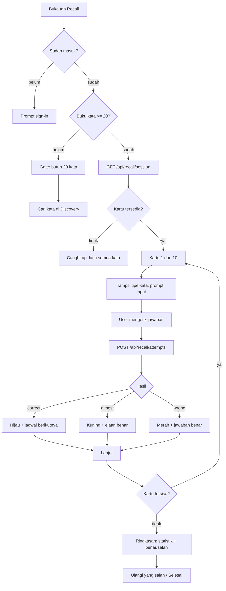

# Planning — Recall

Dokumen eksekusi untuk fitur **Recall**: latihan mengingat aktif dari kata yang
sudah tersimpan di Remembered. Arah latihannya **produksi** — user melihat arti,
definisi, atau kalimat rumpang, lalu mengetik kata bahasa Inggrisnya.

Dokumen ini menggantikan `plan-active-recall.md`, `plan-dictionary-v2.md`, dan
`roadmap.md`. Ketiganya sudah selesai dieksekusi dan dihapus agar tidak ada dua
sumber kebenaran.

---

## 1. Alur Fitur



Aturan alur:

1. **Gate 20 kata.** Sesi butuh perpustakaan minimal 20 kata tersimpan; satu
   sesi berisi 10 kartu. Di bawah 20, tab Recall menampilkan gate yang
   mengarahkan ke Discovery, bukan sesi kosong yang membingungkan.
2. **Satu kartu = satu kata.** Prompt mengikuti mode yang dipilih otomatis:
   terjemahan bahasa preferensi → definisi Inggris → cloze. Kata yang tidak
   punya ketiganya tidak eligible.
3. **Jawaban dinilai di server.** Client tidak pernah menerima `word` atau
   `forms` untuk mode mengetik, jadi jawaban tidak bisa dibaca dari payload.
4. **Setiap attempt mengubah jadwal.** `correct`/`almost` menaikkan interval,
   `wrong`/`revealed` mereset dan menjadwalkan ulang 10 menit kemudian.
5. **Ringkasan menutup sesi.** Statistik sesi (akurasi, benar, salah, rata-rata
   waktu) plus daftar kata yang salah, dengan tombol "Ulangi yang salah".

---

## 2. Aturan Inti

### Mode

| Mode          | Prompt                                  | Jawaban             |
| ------------- | --------------------------------------- | ------------------- |
| `translation` | Terjemahan bahasa preferensi + definisi | kata EN (diketik)   |
| `definition`  | Definisi bahasa Inggris                 | kata EN (diketik)   |
| `cloze`       | Kalimat dengan kata diganti `_____`     | kata EN (diketik)   |
| `choice`      | Kata EN + fonetik                       | pilih 1 dari 4 arti |

`auto` memakai urutan `translation` → `definition` → `cloze`. `choice` hanya
dipakai bila diminta eksplisit.

### Penilaian

| Outcome    | Kondisi                                      |
| ---------- | -------------------------------------------- |
| `correct`  | cocok persis setelah normalisasi             |
| `almost`   | Levenshtein ≤ 1 dan panjang kata ≥ 5         |
| `wrong`    | tidak cocok                                  |
| `revealed` | user menekan "Tunjukkan jawaban"             |

Normalisasi: trim → lowercase → NFKC → curly quote/dash → buang tanda baca di
tepi → hapus diakritik → collapse spasi. Apostrof internal signifikan
(`don't` ≠ `dont`). Panjang jawaban 1–120 karakter.

### Jadwal

```
LADDER = [1, 3, 7, 14, 30, 60, 120]  // hari
```

`correct` menaikkan satu langkah; jawaban cepat (<3 detik, tanpa hint) menaikkan
dua langkah. `wrong`/`revealed` mereset streak dan menjadwalkan 10 menit lagi.
`recall_due_at IS NULL` berarti belum pernah dilatih dan langsung due.

---

## 3. Task 1 (besar) — Mesin Recall + API

Tanpa UI. Semua logika murni bisa diuji dengan `node --test`.

| Mini task | Isi                                                                 | Verifikasi                        |
| --------- | ------------------------------------------------------------------- | --------------------------------- |
| 1.1       | Migrasi `004_active_recall.sql` + `schema.sql`: kolom `recall_*`, tabel `recall_attempts`, index | Dijalankan dua kali tanpa error   |
| 1.2       | `lib/recall/types.ts` + `grade.ts` (normalisasi, Levenshtein, grading) | Test: 6 acceptance grading        |
| 1.3       | `lib/recall/schedule.ts` (ladder, clamp, override)                  | Test: semua cabang jadwal         |
| 1.4       | `lib/recall/cards.ts` (pilih mode, cloze, hint, distraktor)         | Test: fallback mode + cloze tolak ambigu |
| 1.5       | `lib/recall/session.ts` + `repository.ts` (eligibility, antrean, SQL) | Test urutan + eligibility         |
| 1.6       | `GET /api/recall/session`                                           | curl: guest 401, limit clamp, payload |
| 1.7       | `POST /api/recall/attempts` (grading, jadwal, log, idempotensi)     | curl: ownership 404, mode 400     |
| 1.8       | `PATCH /api/recall/attempts/[id]` + `GET /api/recall/stats`         | curl: override sekali, statistik  |

**Definition of done Task 1:** `npx tsc --noEmit`, `npm run lint` 0 warning,
`npm test` lulus, `npm run build` sukses, migrasi sudah diterapkan ke database,
dan endpoint diuji dengan `curl`.

---

## 4. Task 2 (besar) — UI Recall

| Mini task | Isi                                                                 | Verifikasi                        |
| --------- | ------------------------------------------------------------------- | --------------------------------- |
| 2.1       | Tab Recall di navigasi (3 item), ikon-only di bawah `sm`            | `aria-current`, tidak overflow 320px |
| 2.2       | Route `/recall` + state guest, gate <20 kata, loading, error        | Semua state bisa dibedakan        |
| 2.3       | Shell sesi: progress, tipe kata, prompt, input, tombol Next         | Autofocus, Enter memeriksa/lanjut |
| 2.4       | Feedback `correct`/`almost`/`wrong`/`revealed`, hint, reveal, override | Ikon + teks, bukan warna saja  |
| 2.5       | Ringkasan sesi: akurasi, benar/salah, rata-rata waktu, ulangi salah | Angka cocok dengan attempt        |
| 2.6       | Statistik Recall di `/profile`                                      | `dueToday` + `accuracy7d`         |
| 2.7       | Keyboard, aria, dokumentasi README                                  | `npm run lint` 0 warning          |

**Definition of done Task 2:** semua state UI teruji, tidak ada hex langsung,
tidak overflow horizontal di 320px, dan `npm run build` sukses.

---

## 5. Di Luar Scope

- Generasi soal dengan LLM.
- Latihan menulis kalimat atau menerjemahkan paragraf.
- Audio-first recall.
- Notifikasi push atau sinkronisasi kalender.
