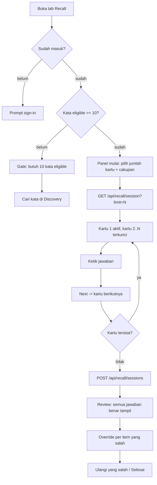

# Planning — Recall

Dokumen eksekusi untuk fitur **Recall**: latihan mengingat aktif dari kata yang
sudah tersimpan di Remembered. Arah latihannya **produksi** — user melihat arti,
definisi, atau kalimat rumpang, lalu mengetik kata bahasa Inggrisnya.

Dokumen ini menggantikan `plan-active-recall.md`, `plan-dictionary-v2.md`, dan
`roadmap.md`.

## Status

| Task | Isi                                        | Status                                            |
| ---- | ------------------------------------------ | ------------------------------------------------- |
| 1    | Mesin grading, jadwal, kartu, dan API      | Selesai (`b8e9626`)                               |
| 2    | Tab Recall dan UI sesi                     | Selesai (`2c11af8`), sebagian digantikan Task 3–4 |
| 3    | Sesi sebagai satu baris fakta + API batch  | Selesai (`abc4f60`)                               |
| 4    | Layout dua kolom, rail nomor, review akhir | Selesai (`e771226`)                               |
| 5    | Perbaikan logika streak                    | Selesai (`f11fc64`)                               |
| 6    | Analytics harian dan bulanan               | Selesai (`0a71d7c`)                               |

Task 3 dan 4 **menggantikan** tiga keputusan di Task 2: gate 20 kata, feedback
per kartu, dan satu baris `recall_attempts` per jawaban. Alasannya ada di §2.

Task 5 dan 6 tidak bergantung pada Task 3–4, tetapi Task 6 memakai
`recall_sessions` sebagai sumber metrik recall. Kalau Task 6 dikerjakan lebih
dulu, metriknya memakai `recall_attempts` dan harus ditulis ulang setelahnya.
Urutan yang disarankan: 3 → 4 → 5 → 6.

---

## 1. Alur Fitur (target)



Perubahan penting dibanding Task 2:

1. **Tidak ada feedback per kartu.** Tombol `Check` menjadi `Next`; user tidak
   melihat benar/salah sampai sesi selesai. Semua jawaban benar baru tampil di
   layar review.
2. **Tidak ada tombol `Show answer`.** `revealed` dihentikan sebagai outcome.
3. **Jumlah kartu bisa dipilih**, minimal dan default 10, maksimum sebanyak
   kata yang eligible.
4. **Satu sesi = satu baris fakta**, bukan satu baris per jawaban.

---

## 2. Keputusan dan Dampaknya

| #   | Keputusan                                                                                      | Dampak / alasan                                                                                                                                                         |
| --- | ---------------------------------------------------------------------------------------------- | ----------------------------------------------------------------------------------------------------------------------------------------------------------------------- |
| D1  | Gate turun dari 20 kata menjadi **10 kata eligible**                                           | Aturan lama bertabrakan dengan "minimal 10 kartu". Kata yang tidak bisa dibuatkan prompt tidak dihitung.                                                                |
| D2  | Maksimum sesi = **jumlah kata eligible**, bukan angka mati 30                                  | Permintaan produk. Bila ada kata tersimpan yang tidak eligible, UI menjelaskan selisihnya.                                                                              |
| D3  | Jawaban dikirim **sekali di akhir** (`POST /api/recall/sessions`)                              | Satu transaksi: sesi, item, dan jadwal per kata. Tidak ada sesi setengah jadi, dan "satu baris fakta per sesi" terpenuhi secara alami.                                  |
| D4  | Tidak ada feedback sebelum submit                                                              | Konsekuensi D3. Client tidak pernah menerima `expected` maupun `outcome` sebelum submit, jadi tidak ada kebocoran.                                                      |
| D5  | `revealed` dipensiunkan dari UI                                                                | Tombolnya dihapus. Nilai lama di database (bila ada) tetap valid; tipe `RecallOutcome` di UI menjadi `correct \| almost \| wrong`.                                      |
| D6  | Override pindah ke layar review                                                                | Justru lebih tepat: user baru tahu jawabannya di akhir, jadi klaim "saya sebenarnya tahu" juga di akhir.                                                                |
| D7  | Item menyimpan snapshot `word` dan `expected`; FK `user_word_id` menjadi `on delete set null`  | Fakta bersifat immutable. Kalau kata di-un-save, riwayat sesi tetap utuh dan hitungan di baris fakta tidak berbohong. Ini **mengubah** keputusan Task 1 (dulu cascade). |
| D8  | Keluar di tengah sesi **menyimpan draft** di `sessionStorage`, dipulihkan saat tab dibuka lagi | Disetujui. Draft memuat kartu, jawaban, posisi, dan waktu mulai dengan kunci per `clientSessionId`; dibuang setelah submit berhasil atau kedaluwarsa 24 jam.            |
| D9  | Semua grafik memakai **komponen Chart dari shadcn/ui** (Recharts), bukan chart buatan sendiri  | Wajib. Konsekuensinya menambah dependency `recharts`, token `--color-chart-*`, dan remap class `chart.tsx` ke token proyek. Detail di §9.7.                             |

---

## 3. Layout

Struktur sama dengan Discovery dan Remembered: satu grid dua kolom dengan
`.detail-split` yang sudah ada.

```
┌─ kolom 1 (1.55fr) ──────────────┐ ┌─ kolom 2 (1fr) ─────────┐
│ Recall · 3 / 10        [×]      │ │ Recall 1–10    [10 ▾]   │
│ ─────────────────────────────── │ │ ─────────────────────── │
│ VERB                            │ │ 1 ✓ answered            │
│ mencapai · meraih               │ │ 2 ✓ answered            │
│ "To succeed in something."      │ │ 3 ● current             │
│                                 │ │ 4 🔒 locked             │
│ [ ketik kata bahasa Inggris… ]  │ │ 5 🔒 locked             │
│ 7 huruf            [Petunjuk]   │ │ …                       │
│                                 │ │ 10 🔒 locked            │
│ [ Next ]                        │ │                         │
└─────────────────────────────────┘ └─────────────────────────┘
```

Aturan:

- Kolom 2 selalu terbuka (`--detail-track: minmax(0, 1fr)`), tidak seperti panel
  detail yang bisa menutup.
- Di bawah `lg`, kolom 2 menjadi **strip horizontal** di atas kartu
  (`order-first lg:order-none`), berisi chip nomor yang sama.
- Rail hanya informatif + navigasi. **Tidak** menampilkan benar/salah selama
  sesi; status yang terlihat hanya `answered`, `current`, dan `locked`.
- Item `answered` boleh dibuka untuk melihat prompt dan jawaban sendiri
  (read-only, tanpa kebenaran), lalu kembali ke kartu aktif.
- Item `locked` tidak bisa diklik. Urutan maju hanya lewat `Next`.
- Setelah submit, rail berganti menjadi navigator review: semua item bisa
  dibuka dan menampilkan jawaban benar + outcome.

---

## 4. Model Data (normalisasi)

Bentuknya star-schema sederhana: satu **fakta** per sesi, detail ternormalisasi
per item, dan state jadwal tetap di `user_words`.

```
neon_auth."user" 1──N recall_sessions 1──N recall_session_items N──1 user_words N──1 vocabulary_words
```

### 4.1 `recall_sessions` — satu baris fakta per sesi

```sql
create table if not exists public.recall_sessions (
  id                uuid primary key,                      -- dibuat di aplikasi
  user_id           uuid not null references neon_auth."user"(id) on delete cascade,
  scope             text not null check (scope in ('due', 'all', 'weak')),
  mode              text not null check (mode in ('auto', 'translation', 'definition', 'cloze', 'choice')),
  requested_size    integer not null check (requested_size between 1 and 500),
  card_count        integer not null check (card_count >= 1),
  correct_count     integer not null default 0 check (correct_count >= 0),
  almost_count      integer not null default 0 check (almost_count >= 0),
  wrong_count       integer not null default 0 check (wrong_count >= 0),
  duration_ms       integer check (duration_ms between 0 and 86400000),
  started_at        timestamptz not null,
  finished_at       timestamptz not null default now(),
  client_session_id text,
  created_at        timestamptz not null default now(),
  constraint recall_sessions_counts_sum
    check (correct_count + almost_count + wrong_count = card_count)
);

create unique index if not exists recall_sessions_client_idx
  on public.recall_sessions (user_id, client_session_id)
  where client_session_id is not null;

create index if not exists recall_sessions_user_finished_idx
  on public.recall_sessions (user_id, finished_at desc);
```

- `correct_count + almost_count + wrong_count = card_count` dijaga constraint,
  jadi baris fakta tidak bisa "lupa" satu item.
- **Akurasi tidak disimpan.** Itu turunan; menyimpannya berarti sumber
  kebenaran ketiga. Dihitung dari hitungan di atas saat dibaca.

### 4.2 `recall_session_items` — detail ternormalisasi

```sql
create table if not exists public.recall_session_items (
  id           uuid primary key,                            -- dibuat di aplikasi
  session_id   uuid not null references public.recall_sessions(id) on delete cascade,
  user_word_id uuid references public.user_words(id) on delete set null,
  position     integer not null check (position >= 0),
  mode         text not null check (mode in ('translation', 'definition', 'cloze', 'choice')),
  outcome      text not null check (outcome in ('correct', 'almost', 'wrong')),
  response     text,
  expected     text not null,        -- snapshot jawaban benar
  word         text not null,        -- snapshot headword, tahan un-save
  duration_ms  integer check (duration_ms between 0 and 600000),
  used_hint    boolean not null default false,
  overridden   boolean not null default false,
  created_at   timestamptz not null default now(),
  unique (session_id, position)
);

create index if not exists recall_session_items_word_idx
  on public.recall_session_items (user_word_id, created_at desc);
```

`expected` dan `word` sengaja diduplikasi dari `vocabulary_words`: fakta tidak
boleh berubah ketika data kamus diperbarui atau kata dihapus (D7). `prompt`
**tidak** disimpan — bentuknya bisa dibangun ulang dari kata, dan menyimpannya
berarti menyalin JSON kamus ke log.

### 4.3 Query rekonsiliasi

Dijalankan setelah migrasi dan dipakai di test:

```sql
select s.id, s.card_count,
       count(i.id)                                        as items,
       count(*) filter (where i.outcome = 'correct')      as correct,
       count(*) filter (where i.outcome = 'almost')       as almost,
       count(*) filter (where i.outcome = 'wrong')        as wrong
from public.recall_sessions s
left join public.recall_session_items i on i.session_id = s.id
group by s.id
having count(i.id) <> s.card_count
    or count(*) filter (where i.outcome = 'correct') <> s.correct_count
    or count(*) filter (where i.outcome = 'almost')  <> s.almost_count
    or count(*) filter (where i.outcome = 'wrong')   <> s.wrong_count;
```

Harus mengembalikan 0 baris.

### 4.4 Migrasi `005_recall_sessions.sql`

`004_active_recall.sql` sudah diterapkan dan tetap dibiarkan sebagai riwayat.
`005` melakukan:

1. **Prasyarat:** `select count(*) from public.recall_attempts` harus 0. Fitur
   belum dipakai di production. Kalau tidak 0, berhenti dan minta keputusan
   backfill.
2. `create table recall_sessions` + index.
3. `create table recall_session_items` + index.
4. `drop table public.recall_attempts` — **destruktif**, butuh konfirmasi.
   Untuk instalasi baru, `neon/schema.sql` cukup berisi dua tabel baru.
5. Kolom `recall_streak`, `recall_lapses`, `recall_due_at`, `last_recalled_at`
   di `user_words` **tidak berubah**; itu state jadwal, bukan fakta.

---

## 5. API

Semua endpoint memakai user dari sesi server: `401` untuk guest, `404` untuk
kata yang bukan milik user.

### 5.1 `GET /api/recall/session`

Query: `limit` (clamp `[10, eligibleCount]`), `scope=due|all|weak`, `mode`,
`pos`.

```json
{
  "data": {
    "scope": "due",
    "mode": "auto",
    "language": "id",
    "librarySize": 34,
    "eligibleCount": 31,
    "totalDue": 12,
    "minSessionSize": 5,
    "defaultSessionSize": 10,
    "sizeOptions": [5, 10, 15, 20, 25, 30, 31],
    "cards": [ { "id": "…", "mode": "translation", "prompt": { … }, "hint": { … } } ]
  }
}
```

- `sizeOptions` dihitung di server supaya UI tidak menebak: kelipatan 5 dari 5,
  ditutup dengan `eligibleCount`.
- `cards` kosong + `eligibleCount < 5` berarti gate.
- Kartu tetap tidak membawa `word`/`forms` untuk mode mengetik.

### 5.2 `POST /api/recall/sessions` (baru)

Body:

```json
{
  "clientSessionId": "uuid",
  "scope": "due",
  "mode": "auto",
  "startedAt": "2026-10-18T09:00:00.000Z",
  "durationMs": 93000,
  "items": [
    {
      "userWordId": "uuid",
      "position": 0,
      "mode": "translation",
      "response": "achieve",
      "durationMs": 4200,
      "usedHint": false
    }
  ]
}
```

Validasi:

- `items` 1–500, `position` unik dan berurutan dari 0.
- Setiap `userWordId` milik user, selain itu `404`.
- `mode` tidak dikenal → `400`.
- `clientSessionId` duplikat → kembalikan sesi lama apa adanya (idempoten).
- `response` kosong dinilai `wrong`.

Server menilai semua item, lalu dalam **satu transaksi**:

1. `insert recall_sessions` (hitungan sudah dijumlahkan di aplikasi).
2. `insert recall_session_items` via `unnest`.
3. `update user_words ... from (values …)` untuk `recall_streak`,
   `recall_lapses`, `recall_due_at`, `last_recalled_at`, `review_count`.
4. `bumpActivity(userId, 0, items.length)`.

Response:

```json
{
  "data": {
    "id": "uuid",
    "finishedAt": "2026-10-18T09:01:33.000Z",
    "counts": { "correct": 7, "almost": 1, "wrong": 2 },
    "accuracy": 0.8,
    "items": [
      {
        "itemId": "uuid",
        "userWordId": "uuid",
        "position": 0,
        "outcome": "correct",
        "expected": "achieve",
        "word": "achieve",
        "response": "achieve",
        "canOverride": false
      }
    ]
  }
}
```

### 5.3 `PATCH /api/recall/sessions/[id]/items/[itemId]` (menggantikan override lama)

Body `{ "overridden": true }`.

- Hanya item milik user, hanya `outcome = 'wrong'`, hanya < 10 menit setelah
  `finished_at`, hanya sekali.
- Dalam satu transaksi: `outcome → correct`, `overridden = true`, hitungan sesi
  bergeser (`wrong_count - 1`, `correct_count + 1`, jumlah tetap sama sehingga
  constraint tetap valid), jadwal kata diperbarui (`streak ≥ 1`, due +1 hari).
- Override kedua → `409`.

### 5.4 `GET /api/recall/stats`

Bentuk data berubah karena sumbernya sesi:

```json
{
  "data": {
    "dueToday": 12,
    "trackedWords": 31,
    "accuracy7d": 0.78,
    "sessions7d": 9,
    "items7d": 84,
    "weakest": [{ "id": "…", "word": "anguish", "lapses": 4, "accuracy": 0.25 }]
  }
}
```

`accuracy7d` = `sum(correct + almost) / sum(card_count)` untuk sesi 7 hari
terakhir. `weakest` dihitung dari `recall_session_items` dengan minimal 3 item.

### 5.5 Endpoint yang dihapus

- `POST /api/recall/attempts`
- `PATCH /api/recall/attempts/[id]`

Tidak ada pemakai lain; UI Recall adalah satu-satunya konsumen.

---

## 6. Task 3 (besar) — Sesi sebagai fakta + API batch

Tanpa UI. Semua logika murni bisa diuji dengan `node --test`.

| Mini task | Isi                                                                                                                          | Acceptance                                                                                                |
| --------- | ---------------------------------------------------------------------------------------------------------------------------- | --------------------------------------------------------------------------------------------------------- |
| 3.1       | Migrasi `005_recall_sessions.sql` + `neon/schema.sql`                                                                        | Dua tabel + index ada; dijalankan dua kali tanpa error; `recall_attempts` hilang; prasyarat 0 baris dicek |
| 3.2       | `lib/recall/types.ts`: `RecallSessionResult`, `RecallSessionItem`, `RecallOutcome` tiga nilai; hapus tipe attempt lama       | `tsc` bersih; `attemptId`/`canOverride` lama tidak tersisa                                                |
| 3.3       | `lib/recall/summary.ts`: `summarize(outcomes)` → hitungan + akurasi; `sizeOptions(eligible)`                                 | Test: jumlah selalu = total; akurasi 0 saat kosong; opsi 10…eligible                                      |
| 3.4       | `lib/recall/session.ts`: `MIN_SESSION_SIZE = 5`, `DEFAULT_SESSION_SIZE = 10`, `clampLimit(value, eligible)`, hapus `MIN_LIBRARY_SIZE`/`MAX_SESSION_SIZE` | Test: 1→5 saat eligible 12; 99→12; eligible 4 → gate                                                     |
| 3.5       | `lib/recall/repository.ts`: `insertSession()` satu transaksi (sesi + item + jadwal), `getSession()`, `listSessionItems()`    | Rekonsiliasi 0 baris; dua kali submit dengan `clientSessionId` sama tidak menambah baris                  |
| 3.6       | `POST /api/recall/sessions`                                                                                                  | Guest 401; kata orang lain 404; `position` duplikat 400; item kosong 400; idempoten                       |
| 3.7       | Override per item + hitungan sesi                                                                                            | Override sekali 200; kedua 409; constraint tetap valid; jadwal berubah                                    |
| 3.8       | `GET /api/recall/stats` dari sesi/item; hapus route attempts                                                                 | `accuracy7d` cocok dengan hitungan manual; tidak ada data user lain                                       |
| 3.9       | Test + verifikasi SQL                                                                                                        | `npm test` lulus; `EXPLAIN` transaksi bersih; rekonsiliasi 0 baris                                        |

**Definition of done Task 3:** `npx tsc --noEmit`, `npm run lint` 0 warning,
`npm test` lulus, `npm run build` sukses, migrasi diterapkan, endpoint diuji
dengan `curl`.

---

## 7. Task 4 (besar) — Layout dua kolom, rail, dan review akhir

| Mini task | Isi                                                                                                               | Acceptance                                                                                          |
| --------- | ----------------------------------------------------------------------------------------------------------------- | --------------------------------------------------------------------------------------------------- |
| 4.1       | `recall-view` memakai `.detail-split` dengan `--detail-track` selalu `minmax(0,1fr)`                              | Kolom 1 lebih lebar; kolom 2 tidak pernah menutup; tidak overflow 320px                             |
| 4.2       | `components/recall/recall-rail.tsx`: nomor 1..N, status `answered/current/locked`, navigasi berurutan             | Item depan tidak bisa diklik; item answered membuka tampilan read-only                              |
| 4.3       | Rail versi mobile: strip horizontal di atas kartu                                                                 | Urutan visual sama; tetap bisa di-scroll tanpa mendorong kartu                                      |
| 4.4       | `recall-start.tsx`: panel mulai dengan pemilih jumlah kartu (`sizeOptions`) + cakupan `due/all` + hitungan        | Default 10; min 10; max = eligible; mengubah jumlah memulai sesi baru                               |
| 4.5       | `recall-session.tsx`: tombol `Next` (tanpa `Check`, tanpa `Show answer`), hint tetap                              | Tidak ada outcome yang tampil sebelum submit; Enter = Next                                          |
| 4.6       | `recall-review.tsx`: semua jawaban benar tampil, per item: prompt, jawaban user, jawaban benar, outcome, override | Override hanya pada `wrong`; angka ringkasan = jumlah item                                          |
| 4.7       | `recall-summary.tsx` dilebur ke review (akurasi, benar/hampir/salah, rata-rata waktu)                             | Tidak ada dua komponen yang menghitung hal sama                                                     |
| 4.8       | State: guest, gate (<5 eligible), caught-up, loading, error, keluar sesi                                         | Enam state bisa dibedakan; dialog keluar menyatakan progres disimpan sebagai draft                  |
| 4.9       | Draft `sessionStorage`: simpan kartu + jawaban + posisi tiap perubahan, pulihkan saat `/recall` dibuka            | Reload di tengah sesi melanjutkan di kartu yang sama; draft hilang setelah submit atau lewat 24 jam |
| 4.10      | `/profile`: `dueToday` + `accuracy7d` dari stats baru; README + dokumen ini                                       | Angka mengikuti `["recall-stats"]` setelah sesi                                                     |

**Definition of done Task 4:** semua state teruji, tidak ada hex langsung,
tidak overflow di 320px, `npm run build` sukses.

---

## 8. Task 5 (besar) — Perbaikan logika streak

### 8.1 Temuan (sudah dibuktikan, bukan dugaan)

Streak saat ini **selalu 0** untuk akun yang punya data. Bukti dari branch
production:

```
activity_date di Postgres       : date
nilai baris                     : 2026-10-18, 2026-10-17, 2026-10-15
nilai yang dibaca driver Neon   : Date(2026-10-17T17:00:00.000Z)   ← Jakarta midnight, di-render UTC
currentStreak(rows)             : 0
currentStreak(rows ternormalisasi): 2   ← jawaban yang benar
```

Rantai penyebabnya:

1. `listUserStreaks` memilih `activity_date` sebagai `date`.
2. Driver Neon mem-parse kolom `date` menjadi objek `Date` JS, bukan string.
3. `currentStreak` membangun `Set<string>` lalu membandingkannya dengan
   `jakartaDateKey()` yang berbentuk `"2026-10-18"`. Perbandingan string vs
   `Date` tidak pernah cocok, sehingga `streak` tetap 0.
4. Tipe `StreakDay.activity_date` dideklarasikan `string`, jadi TypeScript tidak
   bisa menangkap ketidakcocokan ini.

**Jebakan tambahan:** menormalkan dengan `toISOString().slice(0, 10)` juga salah.
`Date` di atas adalah tengah malam Jakarta yang direpresentasikan dalam UTC,
jadi hasilnya `2026-10-17` — mundur satu hari. Satu-satunya normalisasi yang
aman adalah `activity_date::text` di SQL, yang mengembalikan `2026-10-18`.

### 8.2 Masalah ikutan

| #   | Masalah                                                                                  | Dampak                               |
| --- | ---------------------------------------------------------------------------------------- | ------------------------------------ |
| S1  | `listUserStreaks` membaca **seluruh** riwayat tanpa batas, dipakai header dan `/profile` | Boros dan makin lambat seiring waktu |
| S2  | Zona waktu ditulis di dua tempat: `bumpActivity` (SQL) dan `jakartaDateKey` (TS)         | Bisa berbeda tanpa ada yang sadar    |
| S3  | Pill streak tidak di-refresh setelah submit recall                                       | Angka baru muncul setelah reload     |
| S4  | Baris bertanggal masa depan (skew) membuat streak 0 tanpa penjelasan                     | Sulit didiagnosis                    |
| S5  | Tidak ada test untuk `currentStreak`                                                     | Regresi ini lolos                    |

### 8.3 Mini task

| Mini task | Isi                                                                                                                                                             | Acceptance                                                                |
| --------- | --------------------------------------------------------------------------------------------------------------------------------------------------------------- | ------------------------------------------------------------------------- |
| 5.1       | `lib/user-words.ts`: `listUserStreaks` mengembalikan `activity_date::text`; tambah `listStreaksBetween(userId, from, to)`                                       | Query mengembalikan `"2026-10-18"`, bukan `Date`; data lama tetap terbaca |
| 5.2       | `lib/types.ts`: `StreakDay` diberi komentar bahwa tanggal adalah string `YYYY-MM-DD` dari SQL; tambah `StreakDayInput` untuk baris mentah                       | `tsc` menolak pemakaian `Date` di `currentStreak`                         |
| 5.3       | `lib/streak.ts`: konstanta `ACTIVITY_TIME_ZONE` dipakai bersama; `jakartaDateKey` dan `previousDateKey` memakainya                                              | Hanya satu definisi zona waktu di kode                                    |
| 5.4       | `lib/streak.ts`: `streakState(rows)` → `{ current, longest, todayActive }`; `longestStreak` dihitung dari run berurutan                                         | Test: run terpanjang benar walau ada beberapa gap                         |
| 5.5       | `bumpActivity` memakai `ACTIVITY_TIME_ZONE` yang sama (parameter, bukan literal)                                                                                | Tanggal yang ditulis SQL = tanggal yang dihitung TS                       |
| 5.6       | Batasi query: header cukup 400 hari terakhir; `getUserSummary` memakai `listStreaksBetween` 400 hari                                                            | Tidak ada `select *` tanpa batas untuk streak                             |
| 5.7       | `app-shell.tsx` dan `recall-view.tsx` meng-invalidate `["streak"]` setelah submit sesi                                                                          | Pill berubah tanpa reload                                                 |
| 5.8       | Test `tests/streak.test.ts`: baris string, gap, hari ini kosong, kemarin kosong, run terpanjang, dan **regresi `Date`** (memastikan fungsi menolak/menormalkan) | `npm test` lulus; kasus `Date` tidak menghasilkan 0 diam-diam             |
| 5.9       | Verifikasi data nyata: streak akun contoh = 2 (18 dan 17 aktif, 16 kosong)                                                                                      | Angka cocok dengan query SQL manual                                       |

### 8.4 Perilaku yang dipertahankan

- Hari ini kosong **tidak** langsung memutus streak; perhitungan mulai dari
  kemarin. Ini yang membuat streak terasa normal bagi user yang belum aktif hari
  ini.
- Hari yang hanya berisi un-save tidak dihitung aktif.
- Streak harian tetap berbasis `Asia/Jakarta`, bukan zona waktu browser.

**Definition of done Task 5:** pill menampilkan angka benar untuk akun yang
punya data, ada test regresi untuk bug `Date`, dan `npm run lint` 0 warning.

---

## 9. Task 6 (besar) — Analytics harian dan bulanan

### 9.1 Tujuan

Memberi satu halaman yang menjawab "berapa banyak saya belajar, dan seberapa
baik saya mengingatnya" untuk rentang tanggal yang bisa dipilih.

### 9.2 Sumber data

Tidak ada tabel baru. Kedua sumber sudah dinormalisasi per user:

| Metrik                       | Sumber                                           | Catatan                                                                                                                               |
| ---------------------------- | ------------------------------------------------ | ------------------------------------------------------------------------------------------------------------------------------------- |
| Kata ditambahkan, review     | `user_streaks` (`learned_count`, `review_count`) | `learned_count` menghitung **peristiwa simpan**, bukan kata unik; simpan ulang setelah un-save menambah lagi. Label UI: "Words added" |
| Sesi, kartu, akurasi, durasi | `recall_sessions` (Task 3)                       | Akurasi = `(correct + almost) / card_count`                                                                                           |
| Kata terlemah                | `recall_session_items`                           | Minimal 3 item per kata                                                                                                               |
| Streak                       | `lib/streak.ts`                                  | `current` dan `longest`                                                                                                               |

### 9.3 Filter

| Filter         | Nilai                                          | Perilaku                                                   |
| -------------- | ---------------------------------------------- | ---------------------------------------------------------- |
| Preset         | `7d`, `30d`, `90d`, `this-month`, `last-month` | Default `30d`                                              |
| Bulan tertentu | `?month=YYYY-MM`                               | `<input type="month">`, hanya untuk granularitas bulan     |
| Granularitas   | `day` atau `month`                             | Otomatis: `day` bila rentang ≤ 92 hari, `month` bila lebih |

Semua tanggal dihitung di `Asia/Jakarta`, sama dengan streak (S2).

### 9.4 API `GET /api/analytics`

Query: `preset`, `month`, `granularity` (opsional, menimpa otomatis).

```json
{
  "data": {
    "range": {
      "from": "2026-09-19",
      "to": "2026-10-18",
      "granularity": "day",
      "timeZone": "Asia/Jakarta"
    },
    "totals": {
      "wordsAdded": 26,
      "reviews": 14,
      "recallSessions": 3,
      "recallCards": 30,
      "recallAccuracy": 0.8,
      "averageSessionMs": 93000
    },
    "streak": { "current": 2, "longest": 4 },
    "series": [
      {
        "bucket": "2026-10-18",
        "wordsAdded": 23,
        "reviews": 14,
        "recallSessions": 1,
        "recallCards": 10,
        "recallAccuracy": 0.7
      }
    ],
    "weakest": [{ "id": "…", "word": "anguish", "lapses": 4, "accuracy": 0.25 }]
  }
}
```

Aturan:

- `series` **selalu terisi penuh** untuk rentang yang diminta, termasuk bucket
  kosong (nilai 0), supaya grafik tidak bolong.
- `recallAccuracy` bernilai `null` bila `recallCards = 0`, bukan 0. Nol palsu
  akan terbaca sebagai "semua salah".
- Semua tanggal keluar sebagai `YYYY-MM-DD` lewat `::text` (pelajaran dari
  Task 5).
- Guest `401`; data user lain tidak mungkin terbaca karena `user_id` dari sesi.
- Rentang dibatasi maksimum 366 hari.

### 9.5 Mini task

| Mini task | Isi                                                                                                                                                                                                                                                                                | Acceptance                                                                                                                                           |
| --------- | ---------------------------------------------------------------------------------------------------------------------------------------------------------------------------------------------------------------------------------------------------------------------------------- | ---------------------------------------------------------------------------------------------------------------------------------------------------- |
| 6.1       | `lib/analytics/types.ts` + `range.ts`: `resolveRange(preset, month, now)`, `pickGranularity(range)`, `fillSeries(buckets, rows)`                                                                                                                                                   | Test: 7d/30d/90d/this-month/last-month; 92 hari → day, 93 → month; series panjang = jumlah bucket                                                    |
| 6.2       | `lib/analytics/repository.ts`: satu query CTE per metrik + `generate_series`, semua tanggal `::text`                                                                                                                                                                               | Bucket kosong tetap muncul; tidak ada query per hari                                                                                                 |
| 6.3       | `GET /api/analytics` dengan validasi rentang                                                                                                                                                                                                                                       | Guest 401; `preset` tak dikenal → 400; rentang > 366 hari → 400                                                                                      |
| 6.4       | Route `/analytics` + `app/(app)/analytics/page.tsx`; navigasi hanya lewat menu di `/profile`                                                                                                                                                                                       | `/analytics` 200; tidak menambah item di header/bottom nav                                                                                           |
| 6.5       | Baris menu baru di `/profile`: "Analytics" dengan ikon `ChartColumn`                                                                                                                                                                                                               | Baris mengarah ke `/analytics`; gaya sama dengan baris lain                                                                                          |
| 6.6       | `analytics-filters.tsx`: chip preset + input bulan + toggle granularitas                                                                                                                                                                                                           | Perubahan filter mengganti query, bukan reload halaman                                                                                               |
| 6.7       | Pasang Chart shadcn: `npx shadcn@latest add chart` (menambah `components/ui/chart.tsx` + dependency `recharts`), lalu **remap class** `border-border` → `border-line`, `bg-background` → `bg-surface`, `text-muted-foreground`/`fill-muted-foreground` → `text-muted`/`fill-muted` | `chart.tsx` tidak memakai token yang tidak ada; `recharts` tercatat di `package.json`; diff `globals.css` diperiksa agar token proyek tidak tertimpa |
| 6.8       | Token `--color-chart-1`…`--color-chart-5` di `@theme` `app/globals.css`, diturunkan dari palet yang ada; `ChartConfig` merujuk `var(--color-chart-N)`                                                                                                                              | Tidak ada hex di komponen; setiap series punya warna yang kontras dan terbaca di light mode                                                          |
| 6.9       | `analytics-charts.tsx`: `ChartContainer` + `BarChart`/`LineChart` dari Recharts, `ChartTooltip`/`ChartTooltipContent`, `ChartLegend`, `accessibilityLayer`                                                                                                                         | `ChartContainer` punya tinggi eksplisit (mis. `h-[240px]`); tooltip dan legend muncul; grafik bisa dibaca screen reader                              |
| 6.10      | Tabel alternatif (tanggal, kata, review, sesi, akurasi) di `<details>`                                                                                                                                                                                                             | Data yang sama tersedia tanpa grafik; tetap bisa dibaca saat grafik gagal dirender                                                                   |
| 6.11      | State: guest, loading (skeleton), kosong (belum ada aktivitas), error + retry                                                                                                                                                                                                      | Empat state bisa dibedakan; error tidak menghapus filter                                                                                             |
| 6.12      | Test `tests/analytics.test.ts` + README                                                                                                                                                                                                                                            | `npm test` lulus; README menyebut `/analytics`, sumber metrik, dan komponen chart shadcn                                                             |

### 9.6 Batasan yang disengaja

- Grafik memakai komponen Chart shadcn (Recharts) — lihat §9.7. Tidak ada
  implementasi chart buatan sendiri dan tidak ada library chart lain.
- Tidak ada export CSV/PDF di task ini.
- Tidak ada perbandingan antar-user atau leaderboard.
- Metrik "words added" mengukur aktivitas, bukan jumlah kata yang sekarang
  tersimpan; angka itu sudah ada di `/profile` sebagai "Saved words".

### 9.7 Chart wajib memakai komponen shadcn/ui

**Aturan:** setiap visualisasi di `/analytics` dibangun dari
`components/ui/chart.tsx` (shadcn Chart, di atas Recharts v3). Tidak ada chart
buatan sendiri, tidak ada library chart alternatif.

#### Pemasangan

```bash
npx shadcn@latest add chart
```

Yang diharapkan berubah:

| Perubahan                       | Catatan                                                                                                     |
| ------------------------------- | ----------------------------------------------------------------------------------------------------------- |
| `components/ui/chart.tsx` baru  | Komponen milik proyek, boleh diubah                                                                         |
| `recharts` masuk `dependencies` | Cek versi yang terpasang (v3)                                                                               |
| `components.json`               | Tidak perlu berubah; alias sudah benar                                                                      |
| `app/globals.css`               | **Periksa diff.** CLI bisa menambahkan token `--chart-*` bergaya shadcn; jangan sampai menimpa token proyek |

CLI dijalankan non-interaktif (`-y`) agar tidak menunggu prompt, tetapi
hasilnya tetap diperiksa manual sebelum commit.

#### Token warna

Proyek memakai blok `@theme` Tailwind v4, jadi token ditulis sebagai
`--color-chart-N` di `app/globals.css`, bukan `--chart-N` di `:root`. Bentuk ini
membuat `var(--color-chart-1)` **dan** utility `bg-chart-1` sama-sama bekerja.

```css
@theme {
  /* Analytics series. Four of these reuse existing palette values; chart-2 is
     new because the palette has no second neutral series hue. */
  --color-chart-1: #7c3aed; /* words added — accent */
  --color-chart-2: #0ea5e9; /* reviews */
  --color-chart-3: #16a34a; /* recall accuracy — easy */
  --color-chart-4: #d97706; /* recall sessions — medium */
  --color-chart-5: #dc2626; /* incorrect — hard */
}
```

`ChartConfig` merujuk token tersebut, tidak pernah hex:

```tsx
const chartConfig = {
  wordsAdded: { label: "Words added", color: "var(--color-chart-1)" },
  reviews: { label: "Reviews", color: "var(--color-chart-2)" },
} satisfies ChartConfig;
```

Recharts v3 memakai `var(--color-chart-1)` langsung (bukan
`hsl(var(--color-chart-1))`); bentuk lama akan menghasilkan warna transparan.

#### Penyesuaian wajib setelah copy

`chart.tsx` dari shadcn memakai token yang **tidak ada** di proyek ini. Semua
harus dipetakan ulang, dengan pola yang sama seperti `dropdown-menu.tsx`:

| Class shadcn                         | Token proyek                                 |
| ------------------------------------ | -------------------------------------------- |
| `border-border` / `border-border/50` | `border-line` / `border-line/60`             |
| `bg-background`                      | `bg-surface`                                 |
| `bg-popover`                         | `bg-surface`                                 |
| `text-foreground`                    | `text-ink`                                   |
| `text-muted-foreground`              | `text-muted`                                 |
| `fill-muted-foreground`              | `fill-muted`                                 |
| `shadow-xl`                          | tetap (sudah dipakai di `dropdown-menu.tsx`) |

Selain itu:

1. `ChartContainer` wajib punya tinggi eksplisit (`h-[240px]` atau
   `min-h-[240px]`); `ResponsiveContainer` tidak bisa mengukur tanpa itu.
2. Proyek **tidak punya** plugin animasi Tailwind, jadi `animate-in` dan
   sejenisnya di `chart.tsx` harus dibuang — pola yang sama seperti
   `.menu-surface` pada `dropdown-menu`.
3. Tooltip memakai `ChartTooltip` + `ChartTooltipContent` dari `chart.tsx`,
   bukan tooltip buatan sendiri.
4. Legend memakai `ChartLegend` + `ChartLegendContent`.
5. `<BarChart accessibilityLayer>` / `<LineChart accessibilityLayer>` wajib,
   karena tabel di `<details>` adalah padanan yang bisa dibaca screen reader.

#### Jenis grafik yang dipakai

| Visual                    | Komponen                                     | Data                                           |
| ------------------------- | -------------------------------------------- | ---------------------------------------------- |
| Aktivitas per hari/bulan  | `BarChart` + `Bar` (satu `Bar` per metrik)   | `series` dari §9.4                             |
| Akurasi recall per bucket | `LineChart` + `Line`, `connectNulls={false}` | `series.recallAccuracy` (null bila tanpa sesi) |
| Ringkasan                 | kartu angka biasa, **bukan** chart           | `totals`                                       |

`connectNulls={false}` penting: bucket tanpa sesi harus terlihat sebagai jeda,
bukan ditarik menjadi garis lurus yang menyesatkan.

#### Ukuran bundle

`recharts` menambah ukuran client bundle secara signifikan. Karena `/analytics`
adalah route terpisah, biayanya hanya dibayar saat halaman itu dibuka. Mini
task 6.9 memverifikasi ini lewat `npm run build` (ukuran chunk route
`/analytics`) dan memastikan route lain tidak ikut membesar.

**Definition of done Task 6:** filter dan granularitas teruji, series selalu
penuh, akurasi kosong bernilai `null`, semua grafik memakai komponen Chart
shadcn dengan token `--color-chart-*`, dan `npm run build` sukses.

---

## 10. Verifikasi

Perintah:

```bash
npx tsc --noEmit
npm run lint          # 0 error, 0 warning
npm test
npm run build
```

Matriks manual:

| Kasus                                         | Harapan                                                       |
| --------------------------------------------- | ------------------------------------------------------------- |
| Guest                                         | 401 di semua endpoint recall/analytics                        |
| Kata milik user lain                          | 404                                                           |
| `limit=5` dengan 12 kata eligible             | Dinaikkan ke 10                                               |
| `limit=99` dengan 12 kata eligible            | Diturunkan ke 12                                              |
| Eligible 8                                    | Gate, tombol ke Discovery                                     |
| Submit dengan `clientSessionId` sama dua kali | Satu baris fakta, jadwal tidak dobel                          |
| Override dua kali                             | 200 lalu 409                                                  |
| Rekonsiliasi §4.3                             | 0 baris                                                       |
| Payload 50 kartu                              | ≤ 10 KB                                                       |
| Reload di tengah sesi                         | Draft dipulihkan di kartu yang sama                           |
| Streak akun contoh (18, 17, 15)               | `current = 2`, bukan 0                                        |
| Baris `activity_date` dibaca                  | String `YYYY-MM-DD`, bukan `Date`                             |
| Analytics 30d                                 | 30 bucket, termasuk hari kosong                               |
| Analytics rentang 93 hari                     | Granularitas otomatis `month`                                 |
| Bucket tanpa sesi recall                      | `recallAccuracy: null`, bukan 0                               |
| Grafik `/analytics`                           | Memakai `components/ui/chart.tsx`, bukan chart buatan sendiri |
| `chart.tsx` setelah copy                      | Tidak ada `border-border`, `bg-background`, atau `animate-in` |
| Warna series                                  | `var(--color-chart-N)`, tidak ada hex di komponen             |
| `npm run build`                               | Route lain tidak ikut membesar karena `recharts`              |

---

## 11. Pertanyaan Terbuka

Sudah dijawab:

1. ~~**D7**~~ — disetujui: riwayat sesi bertahan setelah kata di-un-save
   (`on delete set null` + snapshot `word`/`expected`).
2. ~~**D8**~~ — disetujui: draft `sessionStorage`, menjadi mini task 4.9.
3. ~~**Drop `recall_attempts`**~~ — boleh, masih tahap development.

Masih terbuka:

4. **D2** — maksimum sesi memakai `eligibleCount` (bukan `librarySize`). Kalau
   ada kata tersimpan yang tidak bisa dibuatkan prompt, UI akan menyebut
   selisihnya. Perlu konfirmasi apakah itu cukup, atau kata tersebut harus
   diperbaiki datanya lebih dulu -> perlu diperbaiki.
5. **Task 6** — preset default `30d` dan batas 366 hari dipilih di dokumen ini.
   Kalau perlu rentang lain (misalnya 1 tahun penuh atau "all time"), sebutkan
   sebelum eksekusi. -> maks 1 tahun range, tapi juga bisa di filter tahun sebelumnya ->
