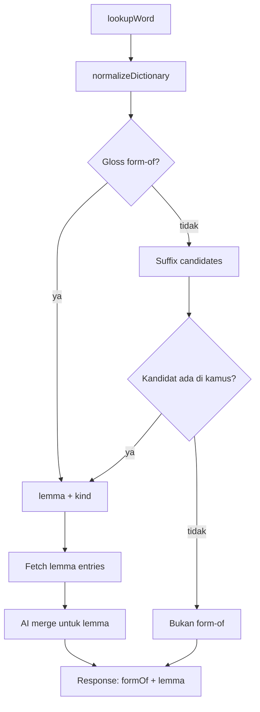

# Planning — Word Forms and Senses

Dokumen ini menangani tiga masalah yang sekarang tercampur di satu model:

1. **Infleksi.** `ran`, `saws`, `children`, `better` bukan lemma. Provider hanya
   memberi gloss "simple past of run", dan aplikasi memperlakukannya sebagai
   makna biasa.
2. **Polisemi.** `run` punya 38 sense di provider; aplikasi hanya menerjemahkan
   satu dan selalu memilih sense pertama.
3. **Homograf.** `saw` (alat) dan `saw` (past of see) berbagi ejaan tapi bukan
   kata yang sama.

## Keputusan

| #   | Keputusan                                                             | Alasan                                                                    |
| --- | --------------------------------------------------------------------- | ------------------------------------------------------------------------- |
| D1  | Deteksi form-of **approach A**: parse gloss Wiktionary                | Deterministik, menangani irregular (`went`, `children`), tanpa dependency |
| D2  | **Fallback B**: aturan sufiks + verifikasi kamus                      | Menutup kata yang gloss-nya tidak ada di provider                         |
| D3  | Gloss selalu menang atas sufiks                                       | Provider menyatakan relasinya secara eksplisit                            |
| D4  | Sufiks hanya diterima bila kandidat benar-benar ada di kamus          | Menghindari tebakan salah (`walked` → `walke`)                            |
| D4b | Sufiks **hanya** dicoba ketika kata tidak ada di kamus (404)          | `his`/`as` punya makna sendiri; menebak sufiks akan salah                 |
| D4c | Kandidat yang ternyata form-of sendiri ditolak                        | Mencegah rantai gloss (`runned` → `runn`)                                 |
| D5  | Tidak ada migrasi skema                                               | `formOf` diturunkan saat baca dari `entries` yang sudah tersimpan         |
| D6  | Makna diambil dari **lemma**, bukan dari kata infleksinya             | `ran` tidak punya terjemahan sendiri di provider                          |
| D7  | UI menampilkan makna **per sense**, bukan digabung per part-of-speech | Dua sense dengan POS sama punya arti berbeda                              |
| D8  | Maksimum 3 sense tampil, sisanya di balik "Show more"                 | 38 sense tidak mungkin ditampilkan sekaligus                              |
| D9  | Forms jadi chip bertag; klik hanya bila ada penanganan navigasi       | Menghindari tombol yang tidak melakukan apa pun                           |

## Arsitektur

## Modul

| File                | Isi                                                                                                  |
| ------------------- | ---------------------------------------------------------------------------------------------------- |
| `lib/word-forms.ts` | `parseFormOf`, `suffixCandidates`, `detectFormOfGloss`, `formKindLabel` — murni, tanpa IO            |
| `lib/form-of.ts`    | `resolveFormOf` — server-only, memverifikasi kandidat sufiks lewat kamus dan mengambil entries lemma |
| `lib/library.ts`    | `senseMeanings` — meratakan entries menjadi daftar sense untuk UI                                    |
| `lib/types.ts`      | `FormKind`, `FormOf`, dan field opsional di `DictionaryResult` / `SavedWord`                         |

## Mini task

| #   | Isi                                                                       | Acceptance                                                                                                                                                                                      |
| --- | ------------------------------------------------------------------------- | ----------------------------------------------------------------------------------------------------------------------------------------------------------------------------------------------- |
| 1   | `lib/word-forms.ts` + `tests/word-forms.test.ts`                          | Gloss `simple past of run`, `plural of child`, `third-person singular … of saw`, `comparative degree of good and well` terurai; `left (“depart…”)` bersih; sufiks menghasilkan kandidat terurut |
| 2   | `detectFormOfGloss` mengabaikan gloss yang lemma-nya sama dengan kata     | `run` tidak dianggap form-of `run`                                                                                                                                                              |
| 3   | `lib/form-of.ts`: verifikasi kandidat sufiks ke kamus, batasi 2 percobaan | `walked` → `walk`; `zzzed` → null                                                                                                                                                               |
| 4   | `senseMeanings` + test                                                    | Sense dengan POS sama tidak digabung; `source: "ai"` dipertahankan per sense                                                                                                                    |
| 5   | `GET /api/dictionary/[word]` mengembalikan `formOf` + `lemma`             | `ran` → `formOf.lemma = "run"`, `lemma.entries` terisi                                                                                                                                          |
| 6   | `GET /api/words/[id]` melakukan hal sama untuk kata tersimpan             | Baris lama tetap terbuka walau lemma gagal diambil                                                                                                                                              |
| 7   | `word-detail.tsx`: banner form-of                                         | Menampilkan "Past tense of run" + tautan ke lemma                                                                                                                                               |
| 8   | `word-detail.tsx`: makna per sense, 3 + "Show more"                       | Dua sense dengan POS sama tampil terpisah                                                                                                                                                       |
| 9   | `word-detail.tsx`: forms bertag dan bisa diklik bila ada handler          | Chip `ran` membuka `ran`; tanpa handler tetap chip statis                                                                                                                                       |
| 10  | Threading `onOpenWord` lewat `DetailAside`                                | Discovery meneruskan; Remembered tidak                                                                                                                                                          |

## Batasan yang disengaja

- Tidak menambah dependency morfologi. Aturan sufiks mencakup kasus umum;
  irregular ditangani gloss.
- Tidak menyimpan `lemma` ke database. Deteksi berjalan saat baca dan hasilnya
  sudah deterministik dari `entries`.
- Tidak mengubah recall pada tahap ini. Card tetap per kata; perubahan ke
  per-sense dicatat sebagai pekerjaan terpisah.
- Lemma hanya diambil **satu level**. `ran` → `run`, bukan `ran` → `run` → …

## Yang tampil di detail word

Urutan panel setelah implementasi:

1. **Header** — kata yang dicari (`ran`), phonetic, chip part-of-speech dari
   lemma.
2. **Banner relasi** — `Past tense of run`; `run` adalah tautan bila panel
   dibuka dari Discovery. Bila lemma gagal diambil, banner tetap tampil dan
   blok makna menjelaskan bahwa maknanya belum tersedia.
3. **Meanings (language)** — satu baris per sense, bukan digabung per POS:
   nomor, POS, badge `AI` per sense, chip terjemahan, definisi Inggris, dan
   satu contoh. Tiga sense pertama tampil; sisanya di balik `Show N more`.
   Sense yang punya terjemahan selalu diurutkan lebih dulu.
4. **Word Forms** — dikelompokkan per POS, chip membawa tag (`past`, `plural`),
   dan bisa diklik bila panel punya handler navigasi. Kata yang sedang dibuka
   tidak dicantumkan di daftarnya sendiri.
5. Sinonim/antonim, footer review, dan source seperti sebelumnya.

Section **English definitions** dan **Example Sentences** sudah dihapus: keduanya
sekarang duplikat dari blok Meanings, yang menampilkan definisi dan satu contoh
per sense. Daftar makna juga menampilkan lebih banyak sense daripada daftar
definisi lama (20 vs 8), jadi tidak ada cakupan yang hilang.

## Hasil validasi (provider langsung)

| Input                     | Hasil                                                                       |
| ------------------------- | --------------------------------------------------------------------------- |
| `ran`                     | `past → run`, 4 entry lemma, terjemahan `mengalir`/`menjalankan` dari lemma |
| `walked`                  | `past → walk`                                                               |
| `running`                 | `present-participle → run`                                                  |
| `children`                | `plural → child`                                                            |
| `mice`                    | `plural → mouse`                                                            |
| `went`                    | `past → go`                                                                 |
| `boxes`                   | `plural → box`                                                              |
| `studied`                 | `past → study`                                                              |
| `saw` / `better` / `left` | tidak dianggap form; makna sendiri dipertahankan                            |
| `his` / `as`              | tidak dianggap form                                                         |
| `runned` (404)            | fallback sufiks → `past → run`                                              |
| `walkedd` (404)           | tetap 404; tidak ada kandidat yang valid                                    |
| `zzzed` (404)             | `past → zzz`; kandidat memang ada di kamus, jadi diterima                   |

Verifikasi: `npx tsc --noEmit`, `npm run lint` (0 error / 0 warning),
`npm test` (172 lulus), `npm run build`.
